#+SETUPFILE: https://fniessen.github.io/org-html-themes/org/setup/html-theme-readtheorg.setup
#+TITLE: Lectures Datascience for Economics
#+AUTHOR: Jan Boone
#+DATE: August 2026
#+PROPERTY: header-args  :session lectures :async t  :results raw drawer
#+PANDOC_OPTIONS: template:~/.local/share/pandoc/templates/eisvogel
#+PANDOC_VARIABLES: titlepage=true
#+PANDOC_OPTIONS: resource-path:.:figures
#+PANDOC_OPTIONS: highlight-style:tango
#+PANDOC_OPTIONS: pdf-engine:xelatex
#+PANDOC_OPTIONS: include-in-header:header.tex
#+PANDOC_VARIABLES: titlepage=true


#+auto_tangle: nil

#+LANGUAGE: en
#+INFOJS_OPT: view:showall toc:t ltoc:t mouse:underline path:http://orgmode.org/org-info.js
#+LATEX_HEADER: \renewcommand{\floatpagefraction}{.8}
#+latex_header: \input{author.tex}
#+latex_header: \setcounter{tocdepth}{1}
#+latex_header: \hypersetup{urlcolor=blue}
#+latex_header: \usepackage{hyperref}
#+latex_engraved_theme: t
#+EXPORT_SELECT_TAGS: export
#+EXPORT_EXCLUDE_TAGS: noexport
#+OPTIONS: toc:nil timestamp:nil num:nil ':t \n:nil @:t ::t |:t ^:{} _:{} *:t TeX:t LaTeX:t
#+OPTIONS: H:6 html-style:nil

#+HTML_HEAD: <link rel="stylesheet" href="./css/Latex.css">
#+HTML_HEAD: <link rel="stylesheet" href="https://latex.now.sh/prism/prism.css">
#+HTML_HEAD: <script src="https://cdn.jsdelivr.net/npm/prismjs/prism.min.js"></script>

#+HTML_HEAD: <style>
#+HTML_HEAD: pre.src code {
#+HTML_HEAD:   background: transparent !important;
#+HTML_HEAD:   border: none !important;
#+HTML_HEAD:   box-shadow: none !important;
#+HTML_HEAD:   padding: 0 !important;
#+HTML_HEAD: }
#+HTML_HEAD: pre.src-python code {
#+HTML_HEAD:   font-size: 1.1em !important;
#+HTML_HEAD: }
#+HTML_HEAD: </style>


#+HTML_HEAD: <meta name="viewport" content="width=device-width, initial-scale=1.0" />
#+HTML_HEAD: <style>
#+HTML_HEAD: body { font-family: Arial, sans-serif; margin: 0; background-color: #f5f7fa; line-height: 1.7; }
#+HTML_HEAD: header { background-color: #1f3c88; color: white; padding: 25px; text-align: center; }
#+HTML_HEAD: main { max-width: 950px; margin: 40px auto; padding: 30px; background: white; border-radius: 10px; box-shadow: 0 3px 12px rgba(0,0,0,0.1); }
#+HTML_HEAD: h1 { margin-top: 0; margin-bottom: 15px; }
#+HTML_HEAD: h2 { margin-top: 35px; margin-bottom: 10px; }
#+HTML_HEAD: h3 { margin-top: 25px; }
#+HTML_HEAD: iframe { width: 100%; height: 900px; border: none; border-radius: 8px; margin-top: 15px; margin-bottom: 15px; }
#+HTML_HEAD: pre { padding: 14px; border-radius: 6px; background: #f7f7f7; overflow-x: auto; }
#+HTML_HEAD: code { font-family: Consolas, Monaco, monospace; }
#+HTML_HEAD: table { font-size: 0.95em; border-collapse: collapse; }
#+HTML_HEAD: thead th { background:#1f3c88 !important; color:white !important; padding:8px; border:1px solid #ddd; }
#+HTML_HEAD: tbody td { padding:8px; border:1px solid #ddd; }
#+HTML_HEAD: figure, img { display: block; margin: 25px auto; max-width: 100%; }
#+HTML_HEAD: .fallback { margin-top: 15px; text-align: center; }
#+HTML_HEAD: .fallback a { color: #1f3c88; text-decoration: none; font-weight: bold; }
#+HTML_HEAD: .fallback a:hover { text-decoration: underline; }
#+HTML_HEAD: .section { margin-bottom: 40px; }
#+HTML_HEAD: div[style*="border-left:4px solid #1f3c88"] { border-radius:6px; padding:14px; }
#+HTML_HEAD: div[style*="border-left:4px solid #2c7a7b"] { border-radius:6px; padding:14px; }
#+HTML_HEAD: </style>

#+BEGIN_EXPORT html
<main>
#+END_EXPORT

* Preamble
:PROPERTIES:
:UNNUMBERED: t
:END:

There are two versions of this document:
- the interactive [[https://janboone.github.io/Datascience-for-economics-lectures/][html version]] which contains the interactive marimo apps
- and the static [[https://janboone.github.io/Datascience-for-economics-lectures/index.pdf][pdf version]] which does not contain interactive apps but shows links to these apps

The html version uses the [[https://github.com/fniessen/org-html-themes][ReadTheOrg]] theme and the pdf version the [[https://github.com/Wandmalfarbe/pandoc-latex-template][Eisvogel latex template]].

* Marimo

In the lectures we use [[https://marimo.io/][marimo notebooks]]. If you follow these lectures as a Tilburg University student, marimo is available at [[https://jupyterlab.uvt.nl/][jupyterlab server.]]

Information on how to install marimo on your own computer can be found [[https://docs.marimo.io/getting_started/installation/][here]]. You can also use [[https://molab.marimo.io/notebooks][molab]].

#+BEGIN_EXPORT latex
\newpage
#+END_EXPORT

* Introduction
:PROPERTIES:
:UNNUMBERED: t
:END:

The goal of these lectures is to build intuition for statistical and machine-learning concepts through simulation. Rather than deriving results analytically, we generate data ourselves, repeat an experiment thousands of times, and read the answer directly from the resulting distribution. This approach — sometimes called *statistical hacking* — serves two purposes: you always know exactly where your data comes from, and you sharpen your Python skills along the way.

Each lecture starts from a concrete economic or statistical question, introduces the Python tools needed to answer it through simulation, and then explains the code in detail. Interactive marimo apps let you experiment with the key parameters and see the effects immediately.

The lectures build on each other. We begin with foundational ideas in statistics (distributions of estimators, bootstrapping, OLS) and move toward machine-learning techniques such as regularisation, neural networks, and treatment-effect estimation.

#+BEGIN_EXPORT html
<div style="border-left:4px solid #444;padding:10px;margin:20px 0;background:#f7f7f7;">
<strong>How to work with these lectures</strong>
<ul>
<li>Read the economic and statistical explanation to understand the intuition.</li>
<li>With the app try to understand the statistical/datascience concepts.</li>
<li>Experiment with the parameters in the interactive apps to predict/see how the results change.</li>
<li>Before looking at the code, try to figure out yourself how the app can be programmed in Python.</li>
<li>Open your own <code>marimo</code> notebook and type Python code yourself rather than copying (all of) it.</li>
<li>Use the review questions to check whether you understand both the intuition and the implementation.</li>
<li>If you get stuck, try debugging yourself first, then consult documentation, classmates, or an LLM.</li>
</ul>
</div>
#+END_EXPORT

#+CAPTION: Roadmap of the course: linking statistical concepts and Python tools
#+NAME: tab:course-roadmap
#+BEGIN_EXPORT html
<div style="overflow-x:auto; margin:20px 0;">
<table style="border-collapse:collapse; width:100%;">
<thead>
<tr style="background:#1f3c88;color:white;">
<th style="padding:8px;border:1px solid #ddd;">Lecture</th>
<th style="padding:8px;border:1px solid #ddd;">Topic</th>
<th style="padding:8px;border:1px solid #ddd;">Statistics / Econometrics</th>
<th style="padding:8px;border:1px solid #ddd;">Python</th>
</tr>
</thead>
<tbody>
<tr><td style="padding:8px;border:1px solid #ddd;">1</td><td style="padding:8px;border:1px solid #ddd;">Distributions and bootstrapping</td><td style="padding:8px;border:1px solid #ddd;">Sampling distributions, CLT, hypothesis testing, OLS</td><td style="padding:8px;border:1px solid #ddd;">numpy simulations, matplotlib, scipy.optimize</td></tr>
</tbody>
</table>
</div>
#+END_EXPORT

--------------

#+BEGIN_EXPORT latex
\newpage
\tableofcontents
\newpage
#+END_EXPORT

* Lecture 1: Statistical Hacking — Distributions and Bootstrapping
:PROPERTIES:
:HTML_CONTAINER_CLASS: section
:CUSTOM_ID: lecture-hacking
:END:

*Skills you learn in this lecture:* simulating sampling distributions, visualising histograms, implementing bootstrapping and OLS from scratch using Python and numpy.

** Learning Objectives

After completing this lecture you should be able to:
- explain why simulating a distribution is a useful alternative to analytical statistical theory
- reproduce the Central Limit Theorem in Python by simulating sample means
- describe what the sampling distribution of an OLS slope looks like and what determines its spread
- implement a bootstrap permutation test to compare two group means without distributional assumptions
- define the loss function for OLS in Python and minimise it numerically
- explain the difference between ridge and lasso penalisation and implement both as modifications to the OLS loss

** Introduction

In your statistics and econometrics courses you have seen analytical results: the sample mean follows an approximately normal distribution by the Central Limit Theorem; the OLS slope has a t-distribution under certain assumptions. These results are elegant but limited. Modern machine-learning models are so complex that no such closed-form distributions exist for their estimated parameters. So how do you assess uncertainty?

The answer is *simulation*. You write the statistical problem in Python, run it thousands of times, and read the distribution from the resulting histogram. This lecture introduces this way of thinking through three closely linked ideas:

1. *Distributions of estimators* — how much does the sample mean or OLS slope vary from sample to sample?
2. *Bootstrapping* — how can you test a hypothesis when you have only one sample and no knowledge of the underlying model?
3. *OLS from scratch* — how does the optimisation problem behind OLS work, and how do ridge and lasso extend it?

Because you generate all the data yourself, you always know the true answer and can check whether the simulation recovers it. That is what makes this approach so useful for building intuition.

The statistical results in this lecture are probably (hopefully) not new to you. What we want to show to you is the new way (simulation or "hacking") in which to understand these results. Later on in the lectures there are topics where we do not have analytical results; then simulation is the only option to gain intuition.

If you like this approach to statistics, you can read a [[https://greenteapress.com/wp/think-stats-2e/][free book]] [cite:@downey-2014-think-stats] or watch YouTube lectures from [[https://www.youtube.com/watch?v=VR52vSbHBAk][Allen Downey]] and [[https://www.youtube.com/watch?v=Iq9DzN6mvYA][Jake VanderPlas]].

** Apps

This lecture has two interactive apps. The first shows how the sampling distribution of the mean and the OLS slope change as you adjust the sample size and noise level. The second demonstrates bootstrap hypothesis testing: you control the effect size and watch whether the test detects it.

*** Distribution of an estimator
:PROPERTIES:
:HTML_CONTAINER_CLASS: section
:END:

In your statistics classes you have probably done hypothesis testing on a sample mean. Then there was "something" with a normal distribution and "another thing" with $\sqrt{n}$ where $n$ was the sample size. Depending on the math content of your course, you have seen these results proved (or not). Here we will explain what these results are and what the intuition is by programming/simulating them. To illustrate, we calculate the mean of $n$ draws out of a uniform distribution; then we do this, say, 10,000 times. Thus we have 10,000 means and we can show the histogram of these means. What does this histogram look like; put differently, what is the distribution of these means? What is the standard deviation of these 10,000 means?

The clear advantage of an analytic proof is that it shows that the result is (always) true. Simulations cannot prove anything. But simulations can help your intuition and sometimes more than a formal proof. Because we actually simulate the concepts, you can literally look at them. For many students the distribution of a mean is a rather abstract concept. We plot this distribution with simulations making it more concrete. The standard error is then the standard deviation of this distribution. Similarly, the distribution of a slope in an OLS regression may sound vague, but when we simulated the different samples and estimate the slope 10,000 times we can plot these 10,000 slopes.


The app below has two parts. In the first part you choose a sample size $n$ and a number of simulations $N$. Each simulation draws a sample of size $n$ from the uniform distribution on $[0,1]$ and records the sample mean. The histogram of the $N$ means shows the sampling distribution of the estimator (the mean); the red curve is the theoretical normal distribution from the Central Limit Theorem. When are these two distributions close and when do they seem different?

In the second part you choose a true slope $\beta_1$, a noise level $\sigma$, and sample size dimensions; i.e. the sample size $n$ of the data and the number of repetitions $N$ of our simulation. The app then runs $N$ OLS regressions and plots both the histogram of $N$ estimated slopes and a fan of 50 fitted regression lines. This illustrates that uncertainty about the slope translates directly into uncertainty about where the regression line lies — and that the uncertainty is largest far from the mean of $x$.

#+BEGIN_EXPORT latex
\url{https://janboone.github.io/datascience-marimo/lecture1\_distributions.html}
#+END_EXPORT

#+BEGIN_EXPORT html
<div style="text-align:center;margin:20px 0;">
  <a href="https://janboone.github.io/datascience-marimo/lecture1_distributions.html"
     target="_blank"
     style="background:#1f3c88;color:white;padding:12px 24px;border-radius:6px;text-decoration:none;font-weight:bold;font-size:1em;">
    ▶ Open app: Distribution of an Estimator
  </a>
</div>
#+END_EXPORT

*** Bootstrap hypothesis test
:PROPERTIES:
:HTML_CONTAINER_CLASS: section
:END:

Above we assume that we know the relevant theoretical (underlying) distributions and draw samples from it. But what if you have a real world dataset and no information on the distribution from which this data is drawn? How can the $n$ sample with $N$ repetitions work then? We illustrate this with data from two groups $A$ and $B$ and we want to test whether the population means of the two groups are the same. That is, the null hypothesis is: $\mu_A = \mu_B$.

Suppose we observe data from two groups $A$ and $B$ and want to know whether their (population) means are the same. In the app, group $B$ is generated as $B = A \times \delta$ where $\delta \leq 1$, so a smaller $\delta$ means a larger difference between the means of the $A$ and $B$ groups. When $\delta = 1$ there is no difference; the null hypothesis is true.

The left panel shows the raw samples and their means. The right panel shows the bootstrap null distribution: the distribution of mean differences you would see if both groups were actually drawn from the same population. The observed difference is marked in red; the shaded tails are the fraction that exceed it in magnitude — that fraction is the p-value.

Drag $\delta$ from $0.80$ toward $1.00$ to watch the p-value rise above $0.05$ as the effect becomes too small to detect with the given sample size.

#+BEGIN_EXPORT latex
\url{https://janboone.github.io/datascience-marimo/lecture1\_bootstrap.html}
#+END_EXPORT

#+BEGIN_EXPORT html
<div style="text-align:center;margin:20px 0;">
  <a href="https://janboone.github.io/datascience-marimo/lecture1_bootstrap.html"
     target="_blank"
     style="background:#1f3c88;color:white;padding:12px 24px;border-radius:6px;text-decoration:none;font-weight:bold;font-size:1em;">
    ▶ Open app: Bootstrap Hypothesis Test
  </a>
</div>
#+END_EXPORT

** Python Code Explanation

In this section we explain the Python code for the apps above. Open a =marimo= notebook alongside this document and type the code yourself; do not just copy and paste. Getting errors and fixing them is the fastest way to learn.

We focus here on modelling the statistical intuitions not on the interactive elements in the =marimo= notebooks.

*** Simulating sampling distributions

**** Import libraries and set parameters

We use =numpy= for numerical computation and =matplotlib= for plotting. 

#+begin_src python
import numpy as np
import matplotlib.pyplot as plt

sample_size = 10        # n observations per sample
N_simulations = 10_000   # N repetitions
#+end_src


**** Generate the data

The key idea: instead of drawing one sample, we draw =N_simulations= samples at once by creating a 2D array (matrix). Each row is one sample (of $n$ draws); each column is one observation within that sample.

#+begin_src python
samples = np.random.uniform(0, 1, (N_simulations, sample_size))
means = samples.mean(axis=1)
#+end_src


~np.random.uniform(low, high, size)~ draws uniformly distributed random numbers. The argument ~(N_simulations, sample_size)~ gives a matrix with =N_simulations= rows and =sample_size= columns.

~.mean(axis=1)~ takes the mean /across columns/ (axis 1), so we get one mean per row; one per simulation. Compare this to ~.mean(axis=0)~ which would average across rows.

**** Plot the histogram

Setting ~density=True~ normalizes the histogram so that the total area equals 1, which makes it comparable to a probability density function. The ~alpha~ parameter controls transparency (0 = invisible, 1 = opaque).

For a sample drawn from Uniform[0,1], the population mean is $\mu = 0.5$ and the population variance is $\sigma^2 = 1/12$. The standard error of the sample mean is therefore $\text{SE} = 1/\sqrt{12n}$. By the Central Limit Theorem, the sampling distribution of the mean is approximately $\mathcal{N}(0.5,\, \text{SE}^2)$ for large $n$.

#+begin_src python :results graphics file output :file ./figures/sampling_distribution_mean.png
fig, ax = plt.subplots(figsize=(8, 4))
ax.hist(means, bins=60, density=True, alpha=0.6, color="steelblue", label="Simulated means")
ax.set_xlabel("Sample mean")
ax.set_ylabel("Density")
ax.set_title(f"Sampling distribution of the mean (n={sample_size})")
se = 1.0 / np.sqrt(12 * sample_size)
x = np.linspace(0.2, 0.8, 300)
pdf = (1.0 / (se * np.sqrt(2 * np.pi))) * np.exp(-0.5 * ((x - 0.5) / se) ** 2)
ax.plot(x, pdf, "r-", lw=2, label=f"Theoretical N(0.5, {se:.4f}²)")
ax.legend()
#+end_src

#+RESULTS:
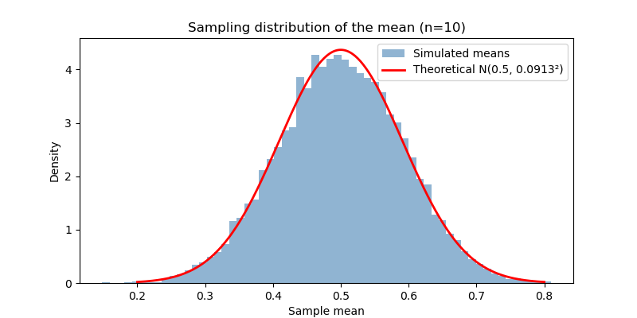

We compute the normal PDF manually using the formula $f(x) = \frac{1}{\sigma\sqrt{2\pi}} e^{-\frac{(x-\mu)^2}{2\sigma^2}}$. Overlaying it on the histogram checks whether the Normal approximation is good for the chosen ~sample_size~.

-----

*** Distribution of the OLS slope

To simulate the distribution of an OLS slope, we need to generate $n$ draws of (x, y) pairs, fit a regression to this sample, record the slope, and repeat this $N$ times.

**** Generate data with broadcasting

#+begin_src python
N_simulations = 1000
n_sample_size = 20
true_slope = 0.5
true_intercept = 1.0
noise = 0.5

x = np.random.normal(0, 1, (N_simulations, n_sample_size))
eps = np.random.normal(0, noise, (N_simulations, n_sample_size))
y = true_intercept + true_slope * x + eps
#+end_src

Here ~true_slope * x~ multiplies every element of the matrix ~x~ by the scalar ~true_slope~. This is called *broadcasting*: =numpy= automatically extends scalar operations to match the shape of the array. In a later lecture we come back to broadcasting in =numpy= because it is very powerful feature.

**** Compute OLS slops

The OLS slope formula for [[https://en.wikipedia.org/wiki/Ordinary_least_squares#Simple_linear_regression_model][a simple regression]] is $\hat\beta_1 = \frac{\sum(x_i - \bar x)(y_i - \bar y)}{\sum(x_i - \bar x)^2}$. We can compute this for all simulations at once:

#+begin_src python
x_c = x - x.mean(axis=1, keepdims=True)
y_c = y - y.mean(axis=1, keepdims=True)

slopes_hat = (x_c * y_c).sum(axis=1) / (x_c ** 2).sum(axis=1)
#+end_src

The argument ~keepdims=True~ ensures the mean has shape ~(N_simulations, 1)~ instead of ~(N_simulations,)~, so that subtracting it from the ~(N_simulations, sample_size)~ matrix ~x~ broadcasts correctly.

We plot the distribution of estimated slopes (histogram) and the theoretical distribution. If you do not know the theoretical distribution of OLS slopes; do not worry: we use simulations in these lectures, not theoretical results. If you do know the distribution of OLS slopes: why do we plot a normal distribution and not a Student $t$ distribution?

#+begin_src python :results graphics file output :file ./figures/sampling_distribution_OLS_slopes.png
# Histogram of estimated slopes
plt.hist(slopes_hat, bins=50, density=True, alpha=0.65, color="coral",
             label="Estimated slopes $\hat \\beta_1$")
plt.axvline(true_slope, color="k", lw=2, linestyle="--",
                label=f"True slope = {true_slope:.1f}")
x_hist_range = np.linspace(slopes_hat.min() - 0.2, slopes_hat.max() + 0.2, 300)
slope_se = noise / np.sqrt(n_sample_size)
normal_slope_pdf = (
    (1.0 / (slope_se * np.sqrt(2 * np.pi)))
    * np.exp(-0.5 * ((x_hist_range - true_slope) / slope_se) ** 2)
)

plt.plot(x_hist_range, normal_slope_pdf, "b-", lw=2,
             label=f"Theoretical N({true_slope:.1f}, {slope_se:.3f}²)")

plt.xlabel("Estimated slope $\hat \\beta_1$")
plt.ylabel("Density")
plt.title("Distribution of OLS slope estimator")
plt.legend(fontsize=8)
plt.tight_layout()
#+end_src

#+RESULTS:
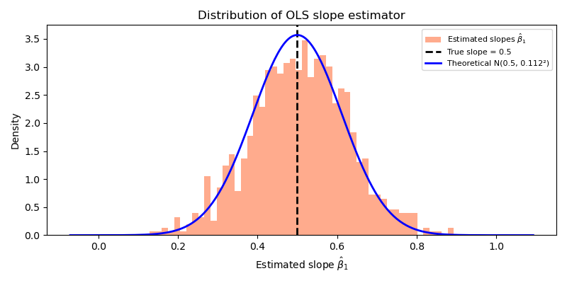

-----

*** Bootstrapping

**** Generate two groups

We generate the $A$ sample from a normal distribution. The $B$ sample is $\delta \in \langle 0,1]$ from the $A$ sample. Hence we know that $\mu_B \leq \mu_A$ (with probability 1.0). Note that we generate these $A$ and $B$ samples once. Above we generated these samples $N$ times; but here we generate the repetitions in a different way.

#+begin_src python :results output
sample_size = 50
delta = 0.95         # B = A * delta; delta < 1 means B is lower than A
A = np.random.normal(10, 1, sample_size)
B = A * delta
observed_difference = A.mean() - B.mean()
print(f"The observed difference equals {observed_difference:.2f}")
#+end_src

#+RESULTS:
:results:
The observed difference equals 0.51
:end:

**** Combine the samples

Under the null hypothesis ($H_0$: both groups come from the same distribution); in other words, the group labels are arbitrary. We combine the two samples:

#+begin_src python
AB = np.concatenate([A, B])
#+end_src


**** Run the permutation test

We randomly relabel the combined sample =N_boot= times and record the difference in means each time. Using ~np.random.choice~ we generate a matrix with labels for the permutation. To see what this function does, check out ~np.random.choice(5,size=(15,10),replace=True)~. Also try ~replace=False~ and see what happens.

For each of the $N$ repetitions (which are in rows, ~axis = 0~), we calculate the difference in means between the labelled $A$ and labelled $B$ samples.

#+begin_src python
N_boot = 10000
rng = np.random.default_rng()

perm_indices = np.random.choice(sample_size,size=(N_boot,2*sample_size),replace=True)

boot_diff = (AB[perm_indices[:, :sample_size]].mean(axis=1)
             - AB[perm_indices[:, sample_size:]].mean(axis=1))
#+end_src


~AB[perm_indices[:, :sample_size]]~ uses *fancy indexing*: for each of the =N_boot= rows we select =sample_size= elements of =AB= according to the permuted indices. In a later lecture we come back to fancy indexing.

**** Compute the p-value

#+begin_src python :results output
p_value = np.mean((boot_diff) >= (observed_difference))
print(f"p-value: {p_value:.4f}")
#+end_src

#+RESULTS:
:results:
p-value: 0.0063
:end:

~(boot_diff) >= (observed_difference)~ produces a boolean array; taking its mean gives the fraction of bootstrap differences that are at least as extreme as the observed one. That fraction is the (one-sided) p-value.

-----

*** OLS from scratch: the optimization approach

The final topic of this lecture (with statistical concepts you have probably seen before) is OLS. Above we use the analytical expression for the slope of a simple regression (i.e. only one independent variable): $\hat\beta_1 = \frac{\sum(x_i - \bar x)(y_i - \bar y)}{\sum(x_i - \bar x)^2}$. The same result can be obtained by minimizing the mean squared error loss function directly. This is useful because the loss function can later be extended with penalty terms to give ridge or lasso.

**** Generate data

#+begin_src python
from scipy import optimize

sample_size = 500
slope1 = -3.0
slope2 = 2.0
constant = 1.0
noise = 1.5
x1 = np.random.normal(0, 1, sample_size)
x2 = np.random.normal(0, 1, sample_size)
y = constant + slope1 * x1 + slope2 * x2 + noise * np.random.normal(0, 1, sample_size)
#+end_src


**** Define the OLS loss

The OLS estimator minimizes the mean squared error:

$$
L(w) = \frac{1}{n} \sum_{i=1}^n \bigl(w_0 + w_1 x_{1i} + w_2 x_{2i} - y_i\bigr)^2
$$

#+begin_src python
def loss_ols(w):
    predictions = w[0] + w[1] * x1 + w[2] * x2
    return np.mean((predictions - y) ** 2)
#+end_src


**** Minimize the loss

#+begin_src python :results output
result = optimize.minimize(loss_ols, x0=[0.0, 0.0, 0.0])
print("Estimated coefficients:", result.x)
#+end_src

#+RESULTS:
:results:
Estimated coefficients: [ 1.00394757 -2.96011743  2.05995201]
:end:

~optimize.minimize~ starts from the initial guess ~x0~ and finds the values of ~w~ that minimize ~loss_ols~. You should recover values close to ~constant=1~, ~slope1=-3~, and ~slope2=2~.

**** Ridge and lasso penalties

Ridge and lasso add a penalty on the coefficients to the loss function. This discourages the model from assigning large coefficients to variables that have little predictive power; a problem that becomes serious when you have many variables.

/Ridge/ uses a squared penalty:

#+begin_src python
lam = 1.0

def loss_ridge(w):
    predictions = w[0] + w[1] * x1 + w[2] * x2
    mse = np.mean((predictions - y) ** 2)
    penalty = lam * np.sum(w[1:] ** 2)   # do not penalise the intercept
    return mse + penalty
#+end_src

/Lasso/ uses an absolute-value penalty:

#+begin_src python
def loss_lasso(w):
    predictions = w[0] + w[1] * x1 + w[2] * x2
    mse = np.mean((predictions - y) ** 2)
    penalty = lam * np.sum(np.abs(w[1:]))
    return mse + penalty
#+end_src

The key difference: lasso can shrink coefficients exactly to zero (performing variable selection), while ridge only shrinks them toward zero. Experiment with different values of ~lam~ to see the effect. We will come back to ridge and lasso regression in the next lecture.

** Summary

In this lecture we introduced statistical simulation as a practical complement to analytical theory. We illustrated the Central Limit Theorem by plotting sampling distributions of the mean, and showed that OLS slope estimates also have a distribution that widens with noise and narrows with sample size.

We then implemented bootstrap hypothesis testing: by repeatedly reshuffling a combined sample under the null hypothesis, we obtained a p-value without any distributional assumption. Finally, we implemented OLS as a numerical optimization problem and extended it to ridge and lasso by adding penalty terms to the loss function.

#+BEGIN_EXPORT html
<div style="border-left:4px solid #1f3c88;padding:10px;margin:15px 0;background:#f5f7fa;">
<strong>Key statistical takeaway</strong><br>
When theory gives no closed-form answer -- which is the norm in machine learning -- simulation fills the gap. Generating your own data and running an experiment thousands of times is a reliable way to build intuition about uncertainty, bias, and the effects of model choices.
</div>
#+END_EXPORT

#+BEGIN_EXPORT html
<div style="border-left:4px solid #2c7a7b;padding:10px;margin:15px 0;background:#eef6f6;">
<strong>Key Python takeaway</strong><br>
Vectorised <code>numpy</code> operations replace explicit Python loops and are orders of magnitude faster. The idioms introduced here -- 2D random arrays, <code>axis</code> reductions, broadcasting, and fancy indexing -- reappear throughout the rest of the course.
</div>
#+END_EXPORT

*Looking ahead:* In the next lecture we consider the issue of variable selection and causal interpretation of coefficients.

** Review Questions

Test your understanding. For each question, write the code in your own =marimo= notebook.

-----

**** TODO review questions:
- plot std of mean(x) against $\sigma/\sqrt(n)$
- test signif. of slope with bootstrapping; how can we bootstrap under null hypoth. that slope equals 0
- plot the separate ols lines from the first app

*** Question 1: Distribution of the sample standard deviation

Above we looked at the distribution of the sample /mean/. The sample /standard deviation/ $s$ also has a distribution.

a. Using the same setup as in section [[*Simulating sampling distributions][Simulating sampling distributions]], simulate the distribution of $s$ across =N_simulations= samples. Plot its histogram.
b. What is the probability that $s < 0.28$? Compute this from the simulated distribution.
c. How does the shape of the distribution of $s$ change as you increase =sample_size=? Is it symmetric?

*** Hint
#+BEGIN_EXPORT html
<details>
<summary><strong>click here</strong></summary>
#+END_EXPORT
- Replace ~means = samples.mean(axis=1)~ with ~stds = samples.std(axis=1, ddof=1)~. The argument ~ddof=1~ gives the unbiased estimator.
- ~np.mean(stds < 0.28)~ gives the fraction of simulated standard deviations below 0.28.
#+BEGIN_EXPORT html
</details>
#+END_EXPORT

-----

*** Question 2: OLS with correlated predictors

In the data-generating process above, ~x1~ and ~x2~ are independent. Now generate correlated predictors:

#+begin_src python
x1 = np.random.normal(0, 1, sample_size)
x2 = 0.8 * x1 + np.sqrt(1 - 0.8**2) * np.random.normal(0, 1, sample_size)
y = constant + slope1 * x1 + 3 * np.random.normal(0, 1, sample_size)
#+end_src

a. Minimise the OLS loss with this correlated ~x2~. How do the estimated coefficients change?
b. Simulate the distribution of the estimated slope on ~x1~ for 1000 repetitions. How does correlation between ~x1~ and ~x2~ affect the spread of this distribution?

-----

*** Question 3: Ridge regression and variable selection

Use the setup from [[*OLS from scratch: the optimisation approach][OLS from scratch: the optimisation approach]] but now generate five predictors, of which only two have a non-zero true coefficient:

#+begin_src python
n = 200
X = np.random.normal(0, 1, (n, 5))   # five predictors
true_w = np.array([1.0, -3.0, 0.0, 0.0, 0.0])
y = X @ true_w + np.random.normal(0, 1, n)
#+end_src

a. Minimise the OLS loss. Do the estimated coefficients for the irrelevant predictors come out exactly zero?
b. Minimise the ridge loss with $\lambda = 1$. How does the result differ?
c. Minimise the lasso loss with $\lambda = 0.1$. Are any coefficients exactly zero?

*** Hint
#+BEGIN_EXPORT html
<details>
<summary><strong>click here</strong></summary>
#+END_EXPORT
- The loss function now takes a vector ~w~ of length 5 and computes ~X @ w~ for the predictions.
- For lasso the gradient of ~|w|~ is undefined at zero, so ~scipy.optimize.minimize~ may not converge cleanly. Try the method ~'L-BFGS-B'~ which handles bounds and subgradients better.
#+BEGIN_EXPORT html
</details>
#+END_EXPORT

-----

*** Question 4: One-sided vs two-sided bootstrap test

The bootstrap test we implemented is *two-sided*: we ask whether $|D_\text{boot}| \geq |D_\text{obs}|$. In some situations we have a directional hypothesis — for instance, we expect $A > B$.

a. Adapt the p-value computation to compute a *one-sided* p-value that tests whether the mean of $A$ is specifically /larger/ than the mean of $B$.
b. For a fixed $\delta = 0.95$ and $n = 50$, run the test 200 times and record the one-sided p-value each time. What fraction of tests reject at the 5% level? Is this what you expect?

-----

*** Question 5: Bootstrap confidence interval

Instead of a hypothesis test, you can also use the bootstrap to construct a confidence interval for the difference in means.

a. From the 10,000 bootstrap differences you computed, extract the 2.5th and 97.5th percentiles. This gives a 95% bootstrap confidence interval for the difference.
b. Does this interval contain zero when $\delta = 1$? What about when $\delta = 0.90$?

*** Hint
#+BEGIN_EXPORT html
<details>
<summary><strong>click here</strong></summary>
#+END_EXPORT
- ~np.percentile(boot_diff, [2.5, 97.5])~ gives the two endpoints of the interval.
- This is the *percentile* bootstrap CI. It is conceptually simple but there are more accurate variants (BCa, studentised) that you can explore if interested.
#+BEGIN_EXPORT html
</details>
#+END_EXPORT

-----------
#+BEGIN_EXPORT latex
\newpage
#+END_EXPORT

* Lecture 2: Variable selection and causality
:PROPERTIES:
:HTML_CONTAINER_CLASS: section
:CUSTOM_ID: lecture-causality
:END:

*Skills you learn in this lecture:* recognizing that significance is not a variable selection criterion, reading and reasoning with directed acyclic graphs (DAGs), simulating fork, pipe, and collider structures in Python to see how controlling for variables changes OLS estimates.


** Learning Objectives

After completing this lecture you should be able to:
- explain why significance is not a valid criterion for selecting variables
- define a directed acyclic graph (DAG) and use it to describe a causal structure
- distinguish fork, pipe, and collider structures and state which variables should (not) be controlled for in each case
- simulate fork, pipe, and collider data in Python using =numpy=
- compute OLS coefficients for simple and multiple regressions from scratch and interpret how they change when a control variable is added or removed

** Introduction

In your statistics and econometrics courses you have learned that OLS measures correlations. A regression coefficient tells you how $Y$ changes with changing values for $X$, but it does not say whether there is a causal relationship. In economics, causal questions matter enormously: if you advise the government to adopt policy $X$ because it will raise $Y$, you need to be sure that $X$ actually /causes/ $Y$, not just that the two are correlated.

Two common but mistaken shortcuts that researchers use when they move from correlations to causal claims are the following.

First, some people select control variables based on statistical significance: add a variable, check whether it is significant, keep it if yes. The xkcd cartoon in Figure ref:fig:significance_xkcd illustrates the absurdity of this approach. If you test 20 unrelated variables at the 5% level, you expect one to appear significant purely by chance. The first app in this lecture lets you explore this [[https://en.wikipedia.org/wiki/Multiple_comparisons_problem][multiple testing problem]] directly.

#+caption: Significance cannot be used for variable selection (in case you need [[https://www.explainxkcd.com/wiki/index.php/882:_Significant][an explanation]]).
#+attr_latex: scale=0.3
#+name: fig:significance_xkcd
[[https://imgs.xkcd.com/comics/significant.png]]

Second, and more subtly, even if you have the right variable in mind as a control, adding it to a regression can either fix a problem or make it dramatically worse; depending on the causal structure. A third variable $Z$ can play three fundamentally different roles:

- the *fork* — $Z$ causes both $X$ and $Y$; failing to control for $Z$ creates a spurious correlation between $X$ and $Y$
  - a simple example is the correlation between the consumption of ice cream and the number of people drowned on a given day; can you guess what $Z$ is here?
- the *pipe* — $Z$ mediates the causal effect of $X$ on $Y$; controlling for $Z$ blocks the causal path you are trying to measure
  - an economic example: you want to know the effect of education on income; should you control for (un)employment?
- the *collider* — both $X$ and $Y$ cause $Z$; controlling for $Z$ induces a spurious correlation between $X$ and $Y$ where none existed
  - suppose running $X$ and cycling $Y$ skills are uncorrelated in the student population; let $Z$ denote membership of the university's elite [[https://en.wikipedia.org/wiki/Duathlon][duathlon]] team. What is the correlation between $X$ and $Y$ conditional on $Z$? Hint: consider a team member with low $X$.
  - as the collider is the least intuitive of the three, below we analyze two more examples; one with simulated and one with real data.

Each of these three structures is represented by a directed acyclic graph (DAG): a diagram with variable names as nodes and arrows showing the direction of causation. The second app lets you switch between the three DAG types and see how the OLS coefficient of $X$ changes when you add $Z$ to the regression.

** Apps

This lecture has two interactive apps. The first demonstrates the multiple testing problem. The second shows the fork, pipe, and collider structures and lets you observe how adding a control variable $Z$ to the regression changes the estimated effect of $X$ on $Y$.

*** Significance and variable selection
:PROPERTIES:
:HTML_CONTAINER_CLASS: section
:END:

All $k$ variables in this app are generated independently of $Y$ — none has a true effect. Nevertheless, some will appear significant at the chosen $\alpha$ level just by chance. The histogram shows the distribution of t-statistics across all $k$ regressions; the red lines mark the critical values. The bar chart on the right compares the expected number of false discoveries ($\alpha \times k$) with the number actually observed. Increase $k$ to 100 or 200 to see how many spurious findings accumulate.

#+BEGIN_EXPORT latex
\url{https://janboone.github.io/datascience-marimo/lecture2\_significance.html}
#+END_EXPORT

#+BEGIN_EXPORT html
<div style="text-align:center;margin:20px 0;">
  <a href="https://janboone.github.io/datascience-marimo/lecture2_significance.html"
     target="_blank"
     style="background:#1f3c88;color:white;padding:12px 24px;border-radius:6px;text-decoration:none;font-weight:bold;font-size:1em;">
    ▶ Open app: Significance and Variable Selection
  </a>
</div>
#+END_EXPORT

*** Fork, pipe, and collider
:PROPERTIES:
:HTML_CONTAINER_CLASS: section
:END:

Select a DAG type from the dropdown and watch the bar chart on the right. The two bars show the OLS coefficient of $X$ from a bivariate regression ($Y \sim X$) and from a multiple regression that also includes $Z$ ($Y \sim X + Z$). The t-statistics are shown in the chart title. The callout below the chart gives the interpretation: for the fork, controlling for $Z$ is the right thing to do; for the pipe and the collider, it is not.

Increase the effect strength $\gamma$ to make the bias more visible, or reduce the sample size to see how estimation uncertainty interacts with the bias.

#+BEGIN_EXPORT latex
\url{https://janboone.github.io/datascience-marimo/lecture2\_causality.html}
#+END_EXPORT

#+BEGIN_EXPORT html
<div style="text-align:center;margin:20px 0;">
  <a href="https://janboone.github.io/datascience-marimo/lecture2_causality.html"
     target="_blank"
     style="background:#1f3c88;color:white;padding:12px 24px;border-radius:6px;text-decoration:none;font-weight:bold;font-size:1em;">
    ▶ Open app: Fork, Pipe, and Collider
  </a>
</div>
#+END_EXPORT

** Python Code Explanation

In this section we explain the key ideas behind the two apps. Open a =marimo= notebook alongside this document and type the code yourself.

We focus on the statistical logic — how to simulate each causal structure and how to compute OLS coefficients from scratch. The interactive elements (sliders etc.) in the apps are added on top of this code.

*** Multiple testing

**** Simulate many "null variables"

We generate $k$ variables that have no effect on $Y$ and run a multiple regression of $Y$ on all $k$ variables. The matrix $\mathbf{X}$ has shape $(n,\, k+1)$: $n$ observations in our (simulated) sample, a column of ones for the intercept and one column per variable.

#+begin_src python
import numpy as np

n, k = 100, 50    
Y = np.random.normal(0, 1, n)
X = np.random.normal(0, 1, (n, k))
#+end_src


**** Compute t-statistics for the multiple regression

OLS gives $\hat\beta = (\mathbf{X}^\top \mathbf{X})^{-1} \mathbf{X}^\top Y$ and the covariance matrix of $\hat\beta$ is $\hat\sigma^2 (\mathbf{X}^\top \mathbf{X})^{-1}$ where $\hat\sigma^2 = \text{RSS}/(n - k - 1)$ and $RSS$ denotes Residual Sum of Squares.

For ease of reference we provide the shape of the vector/matrix in a comment on the same line. In a later lecture we come back to matrix operations like multiplication =@=, transform =T=, =solve= and =inv=.

#+begin_src python
Xmat = np.column_stack([np.ones(n), X])              # (n, k+1)
beta = np.linalg.solve(Xmat.T @ Xmat, Xmat.T @ Y)    # (k+1,)
resid = Y - Xmat @ beta                              # (n,)
sigma2 = np.sum(resid ** 2) / (n - k - 1)            # df = n - k - 1
cov_beta = sigma2 * np.linalg.inv(Xmat.T @ Xmat)     # (k+1, k+1)
se = np.sqrt(np.diag(cov_beta))                      # (k+1,) standard errors
t_stats = beta[1:] / se[1:]                          # (k,); slopes only
#+end_src


The vector ~t_stats~ holds one t-statistic per variable, each testing $H_0: \beta_j = 0$. Under the null, each $t_j \sim t_{n-k-1}$; for $n = 100$ and $k = 50$ the critical value at 5% is approximated by 1.96.

#+begin_src python :results output
n_significant = np.sum(np.abs(t_stats) > 1.96)
print(f"{n_significant} out of {k} variables are 'significant' at 5%")
print(f"Expected: {0.05 * k:.1f}")
#+end_src

#+RESULTS:
: 4 out of 50 variables are 'significant' at 5%
: Expected: 2.5

Every significant result here is a false discovery — by construction.

**** Distribution of false discoveries across repetitions

One run gives one draw from the distribution of false discoveries. To see the full distribution we repeat the simulation $N = 10{,}000$ times and record the number of significant variables for each draw.

#+begin_src python
N = 10_000
counts = np.empty(N, dtype=int)

for i in range(N):
    Yi    = np.random.normal(0, 1, n)
    Xi    = np.random.normal(0, 1, (n, k))
    Xmat_i  = np.column_stack([np.ones(n), Xi])
    beta_i  = np.linalg.solve(Xmat_i.T @ Xmat_i, Xmat_i.T @ Yi)
    resid_i = Yi - Xmat_i @ beta_i
    s2_i    = np.sum(resid_i ** 2) / (n - k - 1)
    se_i    = np.sqrt(np.diag(s2_i * np.linalg.inv(Xmat_i.T @ Xmat_i)))[1:]
    counts[i] = int(np.sum(np.abs(beta_i[1:] / se_i) > 1.96))
#+end_src

#+RESULTS:
: None

Because each t-test is approximately independent and rejects with probability $\alpha = 5\%$ under the null, the count of significant variables follows a $\text{Binomial}(k,\, \alpha)$ distribution with mean $k\alpha$ and variance $k\alpha(1-\alpha)$.

#+begin_src python :results graphics file output :file ./figures/distribution_signif_variables.png
from scipy.stats import binom
import matplotlib.pyplot as plt

alpha = 0.05
xs = np.arange(counts.max() + 2)

sim_probs   = np.array([(counts == x).mean() for x in xs])
binom_probs = np.array([binom.pmf(x,k,alpha) for x in xs])

fig, ax = plt.subplots(figsize=(8, 4))
ax.bar(xs - 0.2, sim_probs,   width=0.35, alpha=0.75,
       color="steelblue", label=f"Simulated ({N:,} runs)")
ax.bar(xs + 0.2, binom_probs, width=0.35, alpha=0.75,
       color="coral",     label=f"Binomial({k}, {alpha})")
ax.set_xlabel(f"Number of 'significant' variables out of k = {k}")
ax.set_ylabel("Probability")
ax.set_title("Distribution of false discoveries — simulation vs. Binomial")
ax.legend()
plt.tight_layout()
#+end_src

#+RESULTS:
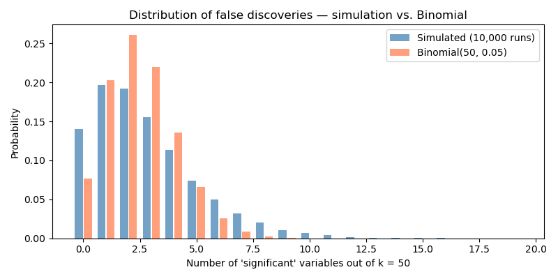

-----

*** Simulating fork, pipe, and collider

For all three structures it is convenient to define a helper function that computes OLS coefficients for a simple or multiple regression using =numpy= linear algebra. As above, the matrix $\mathbf{X}$ starts with a column of ones (the intercept) and the predictor columns. The estimated coefficients are given by $\hat\beta = (\mathbf{X}^\top \mathbf{X})^{-1} \mathbf{X}^\top Y$.

#+begin_src python
def ols(Y, *Xs):
    """Return OLS coefficient vector [intercept, beta_1, ...]."""
    Xmat = np.column_stack([np.ones(len(Y))] + list(Xs))
    return np.linalg.solve(Xmat.T @ Xmat, Xmat.T @ Y)
#+end_src


**** The fork

$Z$ causes both $X$ and $Y$; there is no direct effect from $X$ to $Y$.

As mentioned in the app: if there is an effect between two variables, we assume the effect equals $\gamma$. Here we set $\gamma = 1$.

#+begin_src python :results output
n = 1000
gamma = 1.0
Z = np.random.normal(0, 1, n)
X = gamma * Z + np.random.normal(0, 1, n)    # Z causes X
Y = gamma * Z + np.random.normal(0, 1, n)    # Z causes Y

coef_without_z = ols(Y, X)          # Y ~ X: biased
coef_with_z    = ols(Y, X, Z)       # Y ~ X + Z: correct

print(f"Y ~ X:     coef of X = {coef_without_z[1]:.3f}")
print(f"Y ~ X + Z: coef of X = {coef_with_z[1]:.3f}")
#+end_src

#+RESULTS:
: Y ~ X:     coef of X = 0.454
: Y ~ X + Z: coef of X = -0.020

The bivariate regression picks up the spurious correlation created by $Z$. Adding $Z$ removes it.

**** The pipe

$X$ causes $Z$ which causes $Y$; the causal effect of $X$ on $Y$ is fully mediated by $Z$.

#+begin_src python :results output
X = np.random.normal(0, 1, n)
Z = gamma * X + np.random.normal(0, 1, n)    # X causes Z
Y = gamma * Z + np.random.normal(0, 1, n)    # Z causes Y

coef_without_z = ols(Y, X)     # correct
coef_with_z    = ols(Y, X, Z)  # incorrect

print(f"Y ~ X:     coef of X = {coef_without_z[1]:.3f}  (true total effect ~ {gamma**2:.2f})")
print(f"Y ~ X + Z: coef of X = {coef_with_z[1]:.3f}  (mechanism is blocked)")
#+end_src

#+RESULTS:
: Y ~ X:     coef of X = 1.091  (true total effect ~ 1.00)
: Y ~ X + Z: coef of X = 0.069  (mechanism is blocked)

An economic example: the effect of schooling on income is partly mediated through employment: schooling helps you to find employment. Controlling for employment makes schooling look less relevant, but the real effect exists; it works through employment.

**** The collider

$X$ and $Y$ are independent. Both cause $Z$. Conditioning on $Z$ induces a spurious negative correlation between $X$ and $Y$.

#+begin_src python :results output
X = np.random.normal(0, 1, n)
Y = np.random.normal(0, 1, n)               
Z = gamma * X + gamma * Y + np.random.normal(0, 1, n) 

coef_without_z = ols(Y, X)     # correct
coef_with_z    = ols(Y, X, Z)  # wrong

print(f"Y ~ X:     coef of X = {coef_without_z[1]:.3f}  (correct, near zero)")
print(f"Y ~ X + Z: coef of X = {coef_with_z[1]:.3f}  (spurious negative!)")
#+end_src

#+RESULTS:
: Y ~ X:     coef of X = 0.018  (correct, near zero)
: Y ~ X + Z: coef of X = -0.484  (spurious negative!)

The intuition: if we hold $Z = \gamma X + \gamma Y$ fixed, then a higher $X$ must be offset by a lower $Y$ to keep $Z$ constant. So within any slice of $Z$, $X$ and $Y$ are negatively correlated which is a pure artifact of conditioning.

Finally, we consider the collider in two situations where there is correlation between $X$ and $Y$: first with simulated and then with real data.

**** collider bias with simulated data

Many people have the intuition that adding a control variable to a regression (especially when it turns out to be significant) is a good idea. However, this intuition is wrong if it is applied without thinking. The pipe and collider above are examples where this reasoning is incorrect. Here we consider a collider in a more elaborate example.

We use here the education example by [cite/text/c:@mcelreath-2020-statis-rethin] to illustrate this point (see [[https://www.youtube.com/watch?v=l_7yIUqWBmE][Richard McElreath 's lecture 6]]).
Consider the educational achievements of three generations in one
family: the grandparent, the parent and the (grand)child. We are
interested in the effect of the grandparent's education on the
educational achievement of the grandchild.

Let's denote the child's educational achievement by \(Y\) (the variable
we are interested in) and the grandparent's education \(X\). We want to
understand the effect of \(X\) on \(Y\). Clearly there is the following
path: more educated grandparent leads to more educated parent (\(Z\))
which, in turn, leads to more educated grandchild. The thing we are
interested in is whether there is a direct effect from the grandparent
on the child, /controlling/ for the parent's education.

#+caption: A collider in a more complicated context.
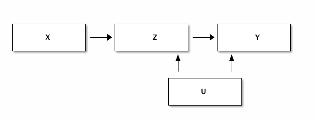

We know that the parent's education has a positive effect on the child's
achievement. A more educated parent will tend to stimulate their
children more, can help with homework etc. In the data that we generate
below, we assume that \(Z = X + ...\) and \(Y = Z + ...\). That is, we
assume that the parent's education feeds one-to-one into the child's
education.

Is it the case that on top of this effect there is a separate
grandparent effect? E.g. because the grandparent is babysitting and a
more educated grandparent reads Hamlet with the 5 year old grandchild.
That is fun and can boost the child's educational achievement.

Another important component of education is the neighbourhood where the
child grows up. We denote this variable \(U\). In the code we assume
that the parent and child grow up in the same neighbourhood (have the
same \(U\) effect). \(U\) is drawn from a standard normal distribution
and the effect on education is given through a multiplication by the
factor =alpha=.

In addition to this, we assume that there is a random component as well
which differs between parent and child.

#+caption: The education example from [cite/text/c:@mcelreath-2020-statis-rethin].
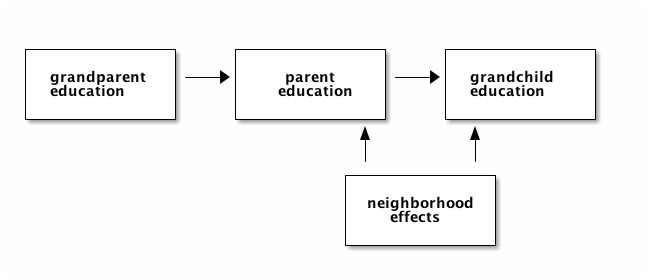

The code below, generates this data and a dataframe =df_collider= that
stores this data.

Look carefully at the code: is there a direct effect from the
grandparent to the grandchild's educational achievement?

We create the dataframe =df_collider= which contains the observable variables $X,Y,Z$ and the unobserved neighbourhood effect $U$.


#+begin_src python :results output
import pandas as pd
import statsmodels.formula.api as smf
sample_size = 5000
alpha = 0.5
X = np.random.normal(size=sample_size)
U = np.random.normal(size=sample_size)
Z = X + alpha*U+0.4*np.random.normal(size=sample_size)
Y = Z + alpha*U+0.4*np.random.normal(size=sample_size)

df_collider = pd.DataFrame({'X':X, 'Y':Y, 'Z':Z, 'U':U})
print(df_collider.head())
#+end_src

#+RESULTS:
:           X         Y         Z         U
: 0  0.004069 -2.603567 -1.244448 -2.173826
: 1  0.383663 -0.350389  0.125116 -0.755560
: 2 -1.539065 -0.910385 -1.668699  0.770156
: 3  0.129300  0.430064  0.863400 -0.128971
: 4  1.076587  2.027661  1.898336  1.184124

Now we run the regression of $Y$ on $X$ controlling for $Z$.

#+begin_src python :results output
results = smf.ols('Y ~ X + Z', data=df_collider).fit()
print(results.summary())

#+end_src

#+RESULTS:
#+begin_example
                            OLS Regression Results                            
==============================================================================
Dep. Variable:                      Y   R-squared:                       0.889
Model:                            OLS   Adj. R-squared:                  0.889
Method:                 Least Squares   F-statistic:                 2.011e+04
Date:                Tue, 29 Sep 2026   Prob (F-statistic):               0.00
Time:                        13:20:24   Log-Likelihood:                -3727.7
No. Observations:                5000   AIC:                             7461.
Df Residuals:                    4997   BIC:                             7481.
Df Model:                           2                                         
Covariance Type:            nonrobust                                         
==============================================================================
                 coef    std err          t      P>|t|      [0.025      0.975]
------------------------------------------------------------------------------
Intercept      0.0107      0.007      1.487      0.137      -0.003       0.025
X             -0.6131      0.013    -45.863      0.000      -0.639      -0.587
Z              1.6152      0.011    142.881      0.000       1.593       1.637
==============================================================================
Omnibus:                        0.695   Durbin-Watson:                   1.936
Prob(Omnibus):                  0.706   Jarque-Bera (JB):                0.737
Skew:                          -0.010   Prob(JB):                        0.692
Kurtosis:                       2.944   Cond. No.                         3.52
==============================================================================

Notes:
[1] Standard Errors assume that the covariance matrix of the errors is correctly specified.
#+end_example

It turns out that grandparent education $X$ has a negative effect on the grandchild's educational achievement $Y$. How is that possible?

To illustrate what is happening, we use an interactive plot made
with [[https://altair-viz.github.io/][altair]].

To condition on =Z= (as we do in a multiple regression), we can drag vertically an interval for $Z$ in the bottom histogram. This selection of \(Z\) turns blue in the scatter plot above and you can drag the selection up and down (conditioning on different values of \(Z\)).

Move this selection up and down and see what happens. In particular:
- for a selection of =Z= in the bottom histogram, what is the relation between =X= and =Y= in the scatter plot?
- for this selection, how does =U= vary in the figure? That is, for a given selection of \(Z\) what is the size of the circles? What is the interpretation? For given $Z$, as grandparent education $X$ is low, what is the size of the $U$ circles?


#+begin_src python
import altair as alt

interval = alt.selection_interval(encodings=['y'])

fig = (
    alt.Chart(df_collider)
    .mark_point()
    .encode(
        x='X',
        y='Y',
        color=alt.condition(
            interval,
            alt.value('steelblue'),
            alt.value('lightgreen')
        ),
        size='U'
    )
    .add_params(interval)
)

hist = (
    alt.Chart(df_collider)
    .mark_bar()
    .encode(
        x='count()',
        y=alt.Y('Z', bin=True),
        color=alt.condition(
            interval,
            alt.value('steelblue'),
            alt.value('lightgrey')
        )
    )
    .add_params(interval)
)

chart_collider = fig & hist
chart_collider.save('./figures/ChartCollider.html')
#+end_src


#+begin_export html
<iframe src="./figures/ChartCollider.html" width="800" height="600"></iframe>
#+end_export


**** collider bias with real data

[cite/text/c:@downey-2023-probab-overt-it chapter 7] discusses a great example of collider bias suggesting (incorrectly) that mothers who smoke during pregnancy have a "protective effect" on their babies if these happen to have low birth weight.
- you can watch his presentation: [[https://www.youtube.com/watch?v=8rUm46mk0Yo&t=964s][probably overthinking low birthweight paradox]]
- or look at the notebook: https://allendowney.github.io/ProbablyOverthinkingIt/birthweight.html
- the website of the book: https://greenteapress.com/wp/probably-overthinking-it/

If you want to run this code on the Tilburg university server, you can access the data with:

#+begin_src python :display output
from zipfile import ZipFile
zip_file = ZipFile('./data/lbw_data.csv.zip')
df = pd.read_csv(zip_file.open('lbw_data.csv'))
df.head()
#+end_src

#+RESULTS:
:    Unnamed: 0  tobacco  birthweight   mort    lbw           bin
: 0           0      2.0       3505.0  False  False  (3500, 3750]
: 1           1      2.0       2940.0  False  False  (2750, 3000]
: 2           2      2.0       2693.0  False  False  (2500, 2750]
: 3           3      1.0       2778.0  False  False  (2750, 3000]
: 4           4      2.0       3175.0  False  False  (3000, 3250]

Then follow Allen Downey's presentation/notebook/book chapter.


** Summary

This lecture introduced two practical pitfalls in variable selection and causal interpretation.

The multiple testing problem shows that significance is not a reliable guide to variable selection: if you test many variables, some will appear significant by chance, with an expected false-discovery rate of exactly significance level $\alpha$.

The fork, pipe, and collider show that whether to control for a third variable $Z$ depends entirely on the causal structure. Controlling for a fork variable is correct. Controlling for a pipe mediator or a collider is incorrect; it either blocks a causal path or introduces a spurious correlation that was not there before.

#+BEGIN_EXPORT html
<div style="border-left:4px solid #1f3c88;padding:10px;margin:15px 0;background:#f5f7fa;">
<strong>Key statistical takeaway</strong><br>
Significance of a coefficient does not mean the variable belongs in your model. Variable selection should be guided by your causal model (the DAG), not by p-values.
</div>
#+END_EXPORT

#+BEGIN_EXPORT html
<div style="border-left:4px solid #2c7a7b;padding:10px;margin:15px 0;background:#eef6f6;">
<strong>Key Python takeaway</strong><br>
<code>np.linalg.solve(X.T @ X, X.T @ y)</code> computes the OLS coefficient vector in one line for any number of predictors. The same matrix operations that worked for simple regression scale directly to multiple regression.
</div>
#+END_EXPORT

/Looking ahead:/ In the next lecture we cover a number of "technical" Python topics that we need for later lectures on datascience methods.

** Review Questions

Test your understanding. For each question, write the code in your own =marimo= notebook.

-----

*** Question 1: False discovery rate

Repeat the multiple testing simulation but now generate $k$ variables where exactly half have a true slope of 0.5 (and half are null).

a. What fraction of the true-effect variables do you correctly detect (power)?
b. Among the "significant" results, what fraction are false discoveries?
c. How does the false-discovery fraction change as you increase $k$ while keeping the number of true signals fixed?

-----

*** Question 2: Fork with partial effect

In the fork simulation above, $X$ has no direct effect on $Y$. Now add a direct effect:

#+begin_src python
Y = 0.5 * X + gamma * Z + np.random.normal(0, 1, n)
#+end_src

a. What coefficient do you expect for $X$ in the regression $Y \sim X$ (without controlling for $Z$)?
b. What coefficient do you expect for $X$ in the regression $Y \sim X + Z$?
c. Run both regressions and check whether the simulated coefficients match your expectations.

-----

*** TODO Question 3: Costly data acquisition

Suppose you work at a ministry and you and your team need to figure out what the effect is of a policy $x$ on an outcome $y$. You can gather data on this relation between $x$ and $y$ but the problem is that the data acquisition is rather expensive. Hence, your colleagues suggest that you gather data sequentially (over time) until you find that the coefficient of $x$ (on $y$) is significant.

Hopefully, in your statistics/econometrics classes you learned that this is a very bad idea. If not, I tell you: this is a bad idea.

Use data simulation to convince your colleagues that collecting data in this way is a bad idea.

**** answer :noexport:

Here we show that a workflow where one gathers data up till the point where the effect is significant is a very bad idea!

First think what would convince your colleages:
- situation where we know that $x$ has no effect on $y$ but with this data gathering process we will find a significant effect for sure:

#+begin_src jupyter-python :file ./figures/pvalues.png
import statsmodels.api as sm
import numpy as np
import matplotlib.pyplot as plt
N = 1000
x = np.random.normal(0,1,size=N)
y = np.random.normal(0,1,size=N)
x = sm.add_constant(x)
p_values = []

for n in range(10,N):
   model = sm.OLS(y[:n], x[:n,:n]).fit()
   p_values.append(model.pvalues[1])
   
plt.scatter(range(10,N),p_values,label='regression outcome')
plt.plot([0,990],[0.05,0.05],label='5% p-value',c='r')
plt.xlabel('number of observations')
plt.ylabel('p-value')
plt.legend();

#+end_src


-----

*** TODO Question 4: Treatment effects


One of the complications when using IV to find causal effects is that treatment effects can differ between subgroups and that these subgroups react differently to the treatment/instrument. Our discussion here is based on Chapter 4 of Angrist and Pischke (2009).

We will consider this in the context of unemployed who are offered a training program. To understand the effects, we will again generate our own data such that we know exactly what all the relevant effects are. The question is then, how do we get these effects from the data.

As before, the learning goals of this section are two fold: (i) learn how to program your own data generating process in python and (ii) understand the statistical issue under considerarion: heterogenous treatment effects.

The government introduces a training program for unemployed. The treatment variable $D_i$ denotes whether (1) or not (0) individual $i$ received training. The instrument $Z_i$ that we use is whether (1) or not (0) $i$ is invited to join the training. 

We have three groups of unemployed:

- compliers join the training if and only if they are invited to do so: $D_i = 1 (0)$ iff $Z_i = 1 (0)$;
- always-takers join the training whether or not they are invited to do so: $D_i =1$ irrespective of $Z_i$;
- never-takers never join the training: $D_i = 0$ irrespective of $Z_i$.

Note that in this training context, the always-takers are a bit "odd": how can you join a training program where you are not supposed to be. The never-takers make more sense in this context: some people may not attend the training even though they were invited to do so. We will not worry about this; the point is that we can conceptually distinguish these groups.

We are interested in the effect of the training program on earnings. We denote by $\beta$ the expected earnings without training. The expected earnings with training is denoted by $\beta+\tau$. Hence, $\tau$ denotes the treatment effects.

Let $j \in \{c,a,n \}$ denote whether an individual is a complier, always-taker or never-taker. We assume that $\beta_j$ and $\tau_j$ vary with $j$.

In particular we assume that the earnings effect for someone in group $j$ is drawn from a normal distribution with mean $\mu = \beta_j$ and standard deviation $\sigma =1$ in case of no training and the effect of training is drawn from a normal distribution with mean $\mu = \tau_j$ and standard deviation $\sigma =1$.

Below we will consider different configurations for $\beta_j, \tau_j$ and see how they affect the estimated effects.

**Exercise** Read the code below and explain what it does. E.g. can you explain how earnings depend on whether someone was invited for the training program?


```python
def accept_complier(invited):
    return invited

def accept_always(invited):
    return np.ones_like(invited)

def accept_never(invited):
    return np.zeros_like(invited)

N_simulations = 10000
fraction_training = 0.2 # 20% of agents are invited to the training
types = ['complier','always_taker', 'never_taker']
β = {'complier': 1, 'always_taker': 2, 'never_taker': 1}
τ = {'complier': 3, 'always_taker': 4, 'never_taker': 1}
n = {'complier': 0.5, 'always_taker': 0.25, 'never_taker': 0.25}
accept = {'complier': accept_complier, 'always_taker': accept_always, 'never_taker': accept_never}
earnings_without = {}
training_effect = {}
earnings = {}
invited = {}
trained = {}
df = pd.DataFrame()
def data_simulation(β = β, τ=τ, n = n):
    for j in types:
        earnings_without[j] = np.random.normal(loc = β[j], scale = 1.0, size = int(n[j]*N_simulations))
        training_effect[j] = np.random.normal(loc = τ[j], scale = 1.0, size = int(n[j]*N_simulations))
        invited[j] = np.random.binomial(1,fraction_training,size = int(n[j]*N_simulations))
        trained[j] = accept[j](invited[j])
        earnings[j] = earnings_without[j]+ trained[j]*training_effect[j]
    column_invited = np.concatenate([invited[j] for j in types],axis=0)
    column_trained = np.concatenate([trained[j] for j in types],axis=0)
    column_earnings = np.concatenate([earnings[j] for j in types],axis=0)
    df = pd.DataFrame({'invited':column_invited, 'trained':column_trained,'earnings':column_earnings})
    return df
 
df = data_simulation()
df.head()
```

We have a dataset now with indicators for who was invited to a training and who attended a training.

We would like to learn the effect of training on earnings.

**Question** Which of the parameters above could we hope to recover? $\tau_c,\tau_a,\tau_n$?

**Question** Hence, if we do some calculations with the data, which number do we want to see?

**Question** Compare the average earnings of people with training with the average earnings of people without training. Is this the number that you expected? Why (not)?


**Exercise** Where does this number come from?

**Question** Perhaps we should use the instrument whether someone is invited or not: compare average earnings of people with and without an invitation to the training.

**Question** Does it help if we compare:
- people with training and an invitation to training *with*
- people without training and no invitation to training


We have seen now that we have no hope of recovering the relevant training effect in the set-up above. So the question is: when can we recover the relevant parameters? That is, what assumptions are needed?

To see how you can analyze this with the set-up above, let's program two obvious cases where this works.

**Question** Explain for each case *why* it works.


```python
n = {'complier': 1.0, 'always_taker': 0.0, 'never_taker': 0.0}
df_compliers_only = data_simulation(n=n)
np.mean(df_compliers_only[df_compliers_only.trained==1].earnings)-np.mean(df_compliers_only[df_compliers_only.trained==0].earnings)
```


```python
β = {'complier': 1, 'always_taker': 1, 'never_taker': 1}
τ = {'complier': 3, 'always_taker': 3, 'never_taker': 3}
df_homog = data_simulation(β=β,τ=τ)
np.mean(df_homog[df_homog.trained==1].earnings)-np.mean(df_homog[df_homog.trained==0].earnings)
```

For a less obvious case where we can retrieve relevant parameters, we will use Angrist and Pischke (2009: chapter 4). In particular, we will verify Theorem 4.4.2.

We work with one sided noncompliance. That is, we allow for never-takers but not for always-takers. 

According to Theorem 4.4.2 the effect of treatment on the treated can be found as:

$$
\frac{E(Y_i|Z_i=1)-E(Y_i|Z_i=0)}{Prob(D_i=1|Z_i=1)}
$$

We first create the dataframe.


```python
n = {'complier': 0.5, 'always_taker': 0.0, 'never_taker': 0.5}
df_one_sided = data_simulation(n=n)

```

**Question** Calculate $Prob(D_i = 1|Z_i =1)$ and denote this `correction_term`.


**Question** Calculate $\frac{E(Y_i|Z_i=1)-E(Y_i|Z_i=0)}{Prob(D_i=1|Z_i=1)}$.


**Question** Which parameter have we recovered?


## Probability of treatment

Consider a situation which is simpler than the one above in the sense that there are no always-takers, nor never-takers.

However, now the instrument ("invited") $Z$ causes the probability of training to increase from 0.2 to 0.6. 30% of people get invited.

**Exercise** Copy/paste python code from the analysis above to generate a dataframe using that $Z_i=1$ implies that the probability of treatment increases from 0.2 to 0.6

**Exercise** Suppose we can observe whether someone received training or not. Use this to calculate the effect of training on earnings.


Suppose we cannot observe whether someone actually did the training or not (e.g. whether or not someone invested effort in the training). We only know ("from a previous study") that explicitly inviting someone for the training ("nudge") increases the probability that they invest training effort from 0.2 to 0.6.

**Exercise** Use the dataframe above to verify what the effect of the nudge is. Call this the `correction_term`. What value should the correction term have?


Angrist and Pischke (2009: chapter 4) Theorem 4.4.1 (LATE Theorem; local average treatment effect) claims that (under some assumptions), we can calculate the effect of training on earnings as:

$$
\frac{E(Y_i|Z_i=1)-E(Y_i|Z_i=0)}{E(D_i|Z_i=1)-E(D_i|Z_i=0)}
$$

**Exercise** Use this expression to calculate the effect of training on earnings.


Now we are going to use an IV estimation to find the same result. Run the following two regressions.


```python
results_first_stage = smf.ols('trained ~ invited', data=df_prob).fit()
results_second_stage = smf.ols('earnings ~ invited', data=df_prob).fit()
```

**Exercise** Use these regressions to calculate the effect of training on earning.


*** Hint
#+BEGIN_EXPORT html
<details>
<summary><strong>click here</strong></summary>
#+END_EXPORT
- ~np.cov(W, Y)[0, 1]~ gives the sample covariance between $W$ and $Y$.
- For the first stage in 2SLS: use the ~ols~ function from the Python Code Explanation section. The fitted values are ~X_hat = b[0] + b[1] * W~.
- The 2SLS estimator equals the IV estimator when there is exactly one instrument; they differ with multiple instruments.
#+BEGIN_EXPORT html
</details>
#+END_EXPORT

-----------
#+BEGIN_EXPORT latex
\newpage
#+END_EXPORT
* Lecture 3: Tensors, broadcasting, indexing, matrix operations
:PROPERTIES:
:HTML_CONTAINER_CLASS: section
:CUSTOM_ID: lecture-tensors
:END:

*Skills you learn in this lecture:* working with multi-dimensional arrays (tensors), selecting data with slicing and fancy indexing, combining arrays with broadcasting, performing matrix algebra, and understanding gradient descent — the algorithm behind neural network training.

** Learning Objectives

After completing this lecture you should be able to:
- use =.shape=, =.ndim=, and =.reshape= to inspect and transform =numpy= arrays of any dimension
- select subsets of arrays using slicing notation and boolean (fancy) indexing
- apply broadcasting rules to combine arrays of different shapes without explicit loops
- perform matrix operations with =numpy=: product =@=, transpose =.T=, inverse and rank via =numpy.linalg=
- implement gradient descent from scratch and explain how the learning rate controls convergence to the OLS solution

** Introduction

In Lectures 1 and 2 we worked with one- and two-dimensional arrays: vectors of observations and matrices with rows as observations and columns as variables. Real-world data often has a more complicated structure than that. An image is a 2D grid of pixel intensities; a dataset of images adds a third dimension for the image index. A panel of incomes across countries, ages and time periods can be viewed as a 3D array. Machine learning frameworks handle this kind of data through /tensors/; =numpy= arrays generalized to any number of dimensions.

Three technical tools make tensor computations easy to handle; once you master them. /Slicing/ and /indexing/ let you extract subsets of a tensor in a single expression without loops. /Broadcasting/ lets you combine arrays of different shapes by automatically stretching the smaller array to match the larger one; this replaces many nested loops with a single vectorized expression. /Matrix operations/ are the language of linear algebra: the matrix product =@=, the transpose =.T=, and the inverse via =numpy.linalg= underpin OLS, regularized regression, and covariance matrices.

The second half of the lecture introduces /gradient descent/, the optimization algorithm inside TensorFlow, PyTorch, and every modern neural network library. We implement it from scratch for a simple linear regression: rather than solving the normal equations analytically, we minimize the mean squared error by iteratively nudging the slope and intercept in the direction that reduces the loss. The interactive app lets you watch this process in real time and experiment with the learning rate.

** Apps

This lecture has two interactive apps. The first lets you enter two $3 \times 3$ matrices and observe matrix operations: addition, subtraction, multiplication, transposition, and inverse. The second app runs gradient descent for a small linear regression and shows both the loss surface and the convergence path.

*** Interactive matrix operations
:PROPERTIES:
:HTML_CONTAINER_CLASS: section
:END:

Enter values for two $3 \times 3$ matrices $A$ and $B$. The app instantly displays their sum, difference, matrix products $AB$ and $BA$ (where these two matrix products are usually not the same), the transpose $A^\top$, the determinant and rank of $A$, and the inverse $A^{-1}$ -- provided $A$ has full rank. Try setting one row of $A$ to a linear combination of another row to see the inverse become undefined.

#+BEGIN_EXPORT latex
\url{https://janboone.github.io/datascience-marimo/lecture3\_matrices.html}
#+END_EXPORT

#+BEGIN_EXPORT html
<div style="text-align:center;margin:20px 0;">
  <a href="https://janboone.github.io/datascience-marimo/lecture3_matrices.html"
     target="_blank"
     style="background:#1f3c88;color:white;padding:12px 24px;border-radius:6px;text-decoration:none;font-weight:bold;font-size:1em;">
    ▶ Open app: Interactive Matrix Operations
  </a>
</div>
#+END_EXPORT

*** Gradient descent for linear regression
:PROPERTIES:
:HTML_CONTAINER_CLASS: section
:END:

The app generates 60 observations from a known linear relationship and asks gradient descent (starting at slope $= 0$, intercept $= 0$) to recover the best-fit line. The left panel shows the mean squared error $L(m, b)$ as a contour plot (representing a bowl in 3D) with the gradient-descent path overlaid. The OLS estimate sits at the bottom of the bowl (lowest point). The right panel tracks the loss at each iteration.

Use the sliders to vary the learning rate $\eta$ and the number of steps. With small $\eta$ the algorithm converges slowly; push $\eta$ too high and the updates overshoot and the algorithm diverges.

#+BEGIN_EXPORT latex
\url{https://janboone.github.io/datascience-marimo/lecture3\_gradient\_descent.html}
#+END_EXPORT

#+BEGIN_EXPORT html
<div style="text-align:center;margin:20px 0;">
  <a href="https://janboone.github.io/datascience-marimo/lecture3_gradient_descent.html"
     target="_blank"
     style="background:#1f3c88;color:white;padding:12px 24px;border-radius:6px;text-decoration:none;font-weight:bold;font-size:1em;">
    ▶ Open app: Gradient Descent for Linear Regression
  </a>
</div>
#+END_EXPORT

** Python Code Explanation

Open a =marimo= notebook alongside this document and type the code yourself. We build up from basic tensor manipulation to gradient descent.

*** Tensors and shape

A /tensor/ is a =numpy= array with one or more dimensions. Every array has a =.shape= attribute --a tuple giving its size along each axis-- and =.ndim= for the number of dimensions.

#+begin_src python :results output
import numpy as np

x = np.random.normal(0, 1, 100)       # 1-D tensor: 100 numbers
print(x.shape, x.ndim)               

M = np.random.normal(0, 1, (4, 5))   # 2-D tensor (a matrix)
print(M.shape, M.ndim)                

T = np.random.normal(0, 1, (3, 28, 28))   # 3-D: 3 images of 28×28 pixels
print(T.shape, T.ndim)                 
#+end_src

#+RESULTS:
: (100,) 1
: (4, 5) 2
: (3, 28, 28) 3

Use =.reshape= to reorganize the elements without changing their values, as long as the total count stays the same.

#+begin_src python :results output
x2 = x.reshape(10, 10)     
x3 = x.reshape(4, 5, 5)   
print(x2.shape)            
print(x3.shape)            
#+end_src

#+RESULTS:
: (10, 10)
: (4, 5, 5)

=np.newaxis= inserts a dimension of size 1; useful for broadcasting. The slicing notation =x[:5]= means: take the 5 first elements of =x= along axis zero.

#+begin_src python :results output
col = x[:5, np.newaxis]      
row = x[:5][np.newaxis, :]  
print(col.shape, row.shape)
#+end_src

#+RESULTS:
: (5, 1) (1, 5)

Instead of =np.newaxis= you can also use =None= like =x[:5, None]=.

*** Slicing and indexing

Slicing uses the notation =start:stop:step= for each dimension, separated by commas. =:= means "all elements". The notation =::2= then means "every other element".

#+begin_src python
x = np.arange(1, 101).reshape(10, 10)   # 10×10 matrix, values 1 to 100

x[0, :]           # first row, all columns
x[:, 4]           # fifth column (index starts at 0)
x[:2, :2]         # top-left 2×2 block
x[0, 5:]          # second half of the first row
x[0, 5::2]        # every other element from that half
x[1::2, 1::2]     # every other row and column, starting from index 1
#+end_src


The last command yields:

: array([[ 12,  14,  16,  18,  20],
:        [ 32,  34,  36,  38,  40],
:        [ 52,  54,  56,  58,  60],
:        [ 72,  74,  76,  78,  80],
:        [ 92,  94,  96,  98, 100]])

/Fancy indexing/ selects elements using a boolean array.

#+begin_src python
x[x > 50]                       # values exceeding 50, as a 1-D array
x[(x >= 30) & (x <= 40)]        # & for "and", | for "or"
#+end_src

The last command gives:
: array([30, 31, 32, 33, 34, 35, 36, 37, 38, 39, 40])

Boolean masks from one array can select from another of the same shape. The classic use: colour scatter-plot points by sign.


#+begin_src python :results graphics file output :file ./figures/colored_sin.png
t = np.linspace(0, 2 * np.pi, 300)
y = np.sin(t)
import matplotlib.pyplot as plt
plt.plot(t[y >= 0], y[y >= 0], "b")   # positive part: blue
plt.plot(t[y < 0],  y[y < 0],  "r")   # negative part: red
#+end_src

#+RESULTS:
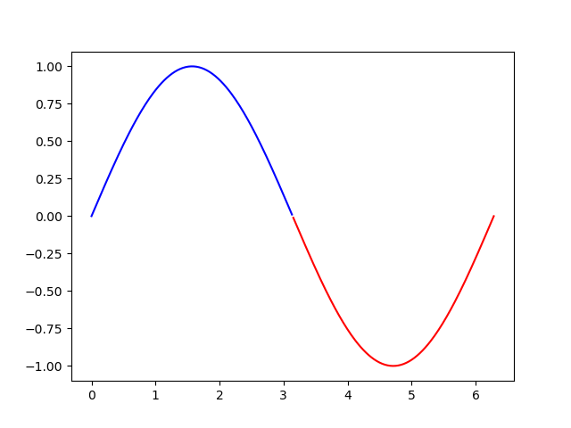

*** Broadcasting

Broadcasting lets =numpy= combine arrays of different shapes by stretching dimensions of size 1 to match the other array. The broadcasting rule: check from the rightmost dimension leftward whether:

1. Dimensions of equal size: fine.
2. One dimension equals 1: fine
3. Neither of the above: error.

A practical example from panel econometrics: individual fixed effects $I_i$ and time effects $T_t$, giving predictions $y_{it} = I_i + T_t$.

#+begin_src python :results output
I = np.arange(0, 100, 10)    # 10 individual effects, shape (10,)
T = np.arange(3)              # 3 time effects, shape (3,)

y = I[:, np.newaxis] + T[np.newaxis, :]   # (10,1) + (1,3) → (10,3)
print(y.shape)                # (10, 3)
print(y[9, 1])                # 91 = 90 + 1  ✓
#+end_src

#+RESULTS:
: (10, 3)
: 91

No nested loop over $i$ and $t$ — a single expression covers all 30 combinations.

Practice broadcasting yourself by defining two tensors:

#+begin_src python
x = np.random.normal(0,1,size=100)
y = np.random.normal(0,1,size=100)
#+end_src

and then asking which of the following can be added? First, think about it.
Then check by running the code in a cell (see whether or not you get an error).

- =x+y=
- =x.reshape(10,10)+y=
- =x.reshape(10,10)+y.reshape(4,5,5)=
- =x.reshape(10,10)+y.reshape(10,10,1)=
- =x.reshape(10,10)+y.reshape(1,10,10)=
- =x.reshape(10,10)+y.reshape(5,10,2)=
- =x.reshape(10,10)+y.reshape(100,1,1)=

For more information on broadcasting check this [[https://numpy.org/doc/stable/user/basics.broadcasting.html][numpy documentation]].


*** Matrix operations

The key matrix operations in =numpy= with $k$ by $l$ matrix $A$ and $m$ by $n$ matrix $B$:

| Expression | Meaning |
|---|---|
| =A @ B= | matrix product (must be the case that $l=m$) |
| =A * B= | element-wise product (shapes must broadcast) |
| =A.T= | transpose |
| =np.linalg.solve(A, b)= | solve $Ax = b$ ($A$ must be a square matrix: $k=l$) |
| =np.linalg.inv(A)= | matrix inverse $A^{-1}$, must be square |
| =np.linalg.det(A)= | determinant |
| =np.linalg.matrix_rank(A)= | rank |
| =np.diag(v)= | diagonal matrix from vector, or extract diagonal |

Matrix product =@= differs from element-wise multiplication =*=. By doing the calculations by hand, check the following:

#+begin_src python :results output
A = np.array([[1, 2], [3, 4]])
B = np.array([[0, 1], [1, 0]])

print(A * B)
print("---------")
print(A @ B)   
#+end_src

#+RESULTS:
: [[0 2]
:  [3 0]]
: ---------
: [[2 1]
:  [4 3]]

Before we try to calculate $A^{-1}$, let's check whether $A$ has full rank:

#+begin_src python :results output
print(np.linalg.det(A))
print(np.linalg.matrix_rank(A))
print(np.linalg.inv(A))
#+end_src

#+RESULTS:
: -2.0000000000000004
: 2
: [[-2.   1. ]
:  [ 1.5 -0.5]]

As $\det(A) \neq 0$, $A$ has full rank; and, indeed, the rank of $A$ equals 2 (which is max. rank for a 2 by 2 matrix). Hence, we can calculate the inverse of $A$.

We can check whether the inverse is correct:

#+begin_src python
np.linalg.inv(A) @ A
#+end_src

#+RESULTS:
: array([[1.00000000e+00, 0.00000000e+00],
:        [1.11022302e-16, 1.00000000e+00]])


As we saw in the previous lecture, we can write OLS in matrix form as $\hat\beta = (X^\top X)^{-1} X^\top y$ and covariance matrix $\hat\sigma^2(X^\top X)^{-1}$.

We first simulate our own data: $n$ observations and 4 $x$ variables. We then define $y$; what are the slope variable and what is the intercept?

#+begin_src python :results output
n, k = 200, 4
X    = np.random.normal(0, 1, (n, k))
y    = X @ np.array([1, 0.5, -0.5, 0.3]) + np.random.normal(0, 1, n)
#+end_src


We define the matrix $X$ with observations, derive our estimated coefficients $\hat \beta$, calculate the residuals which we need for the standard errors:

#+begin_src python :results output
Xmat     = np.column_stack([np.ones(n), X])
beta_hat = np.linalg.solve(Xmat.T @ Xmat, Xmat.T @ y)
resid    = y - Xmat @ beta_hat
sigma2   = np.sum(resid ** 2) / (n - k - 1)
se       = np.sqrt(np.diag(sigma2 * np.linalg.inv(Xmat.T @ Xmat)))
print("estimates:  ", beta_hat.round(3))
print("std errors: ", se.round(3))
#+end_src

#+RESULTS:
: estimates:   [-0.059  1.043  0.487 -0.388  0.353]
: std errors:  [0.073 0.067 0.073 0.07  0.08 ]

A square $n \times n$ matrix $A= X^\top X$ is invertible if and only if det$(A) \neq 0$ or equivalently rank$(A) = n$. In statistics, a near-zero determinant indicates /multicollinearity/: one predictor is a linear combination of the others.

*** Gradient descent from scratch
:PROPERTIES:
:header-args: :session assignment_NN :python ~/my_env/tf_env/bin/python3  :async t  
:END:

The OLS formula $\hat\beta = (X^\top X)^{-1} X^\top y$ minimizes the MSE analytically. For models with no closed-form solution (like a neural network) we use /gradient descent/: start somewhere and step downhill.

For simple linear regression $\hat y = mx + b$ the MSE loss is

$$L(m, b) = \frac{1}{n}\sum_i (y_i - m x_i - b)^2$$

The gradients are

$$\frac{\partial L}{\partial m} = \frac{2}{n}\sum_i (m x_i + b - y_i)\,x_i, \qquad \frac{\partial L}{\partial b} = \frac{2}{n}\sum_i (m x_i + b - y_i)$$

Update rule with learning rate $\eta$: $m \leftarrow m - \eta\,\partial L/\partial m$ and similarly for $b$. Here we set a seed (42) to make sure that your results will be the same as the ones below. We start our gradient descent at $(m,b) = (0,0)$ and use learning rate $\eta = 0.3$. Note that we use the derivatives of $L$ derived above in our updating of $m$ and $b$.

#+begin_src python :results output
import numpy as np
import tensorflow as tf

rng = np.random.default_rng(42)
n   = 60
x   = np.sort(rng.uniform(0, 2, n))
y   = 0.5 * x + 0.3 + rng.normal(0, 0.2, n)

# OLS:
Xmat  = np.column_stack([np.ones(n), x])
b_hat = np.linalg.solve(Xmat.T @ Xmat, Xmat.T @ y)
print(f"OLS: intercept = {b_hat[0]:.4f}, slope = {b_hat[1]:.4f}")

# Gradient descent starting from (m, b) = (0, 0):
lr, m, b = 0.3, 0.0, 0.0
for step in range(200):
    resid = (m * x + b) - y
    m -= lr * 2 * np.mean(resid * x)
    b -= lr * 2 * np.mean(resid)

print(f"GD:  intercept = {b:.4f}, slope = {m:.4f}")
#+end_src

#+RESULTS:
: OLS: intercept = 0.2868, slope = 0.4728
: GD:  intercept = 0.2868, slope = 0.4728

In TensorFlow the same loop is written with =tf.Variable=, =tf.GradientTape= (which computes gradients automatically), and =assign_sub= (which does the subtraction update in-place). We will see this syntax when we build neural networks. For now, consider the following example which is copied from [[https://www.youtube.com/watch?v=Yyv-ng0_OTU&t=506s][this SciPy 2019 Tutorial]].

We define the tensorflow variables =m,b= and give them a starting value. Tensorflow now knows that =m,b= are variables that will be varied (trained) later on.

#+begin_src python
m = tf.Variable(0.)
b = tf.Variable(0.)
#+end_src


We can look at the variables, but they are not “easy to look at” as they contain more information than just the value. If we are only interested in the value, we can use the =numpy()= method on the variable.

#+begin_src python :results output
print(m)
print(m.numpy())
#+end_src

#+RESULTS:
: <tf.Variable 'Variable:0' shape=() dtype=float32, numpy=0.0>
: 0.0

We define a function that predicts =y= for given =x=. Note that =tf= “knows” that =m,b= are variables because of the way we defined these variables above. Hence, they are not explicitly mentioned in the function definition as variables.

#+begin_src python
def predict(x):
    y = m * x + b
    return y
#+end_src

We define our loss function: sum of squared differences between =y_pred= and =y_true=.

#+begin_src python
def squared_error(y_pred, y_true):
    return tf.reduce_mean(tf.square(y_pred - y_true)) 
#+end_src


To see what =reduce_mean= does, consider the following example. If the tensor =vector= has more than 1 dimension, you can specify the axis along which the reduction needs to take place.

#+begin_src python :results output
vector = tf.constant([[1., 2., 3., 4.]])
print(tf.reduce_mean(vector).numpy())
#+end_src

#+RESULTS:
: 2.5

As above, we use gradient descent to gradually improve our guess for =m= and =b=.

#+begin_src python :results output
learning_rate = 0.3
steps = 200

for i in range(steps):
  
    with tf.GradientTape() as tape:
        predictions = predict(x)
        loss = squared_error(predictions, y)
    
    gradients = tape.gradient(loss, [m, b])
  
    m.assign_sub(gradients[0] * learning_rate)
    b.assign_sub(gradients[1] * learning_rate)
  
    if i % 20 == 0:    
        print("Step %d, Loss %f" % (i, loss.numpy()))
#+end_src

#+RESULTS:
#+begin_example
Step 0, Loss 0.698773
Step 20, Loss 0.022170
Step 40, Loss 0.022144
Step 60, Loss 0.022143
Step 80, Loss 0.022143
Step 100, Loss 0.022143
Step 120, Loss 0.022143
Step 140, Loss 0.022143
Step 160, Loss 0.022143
Step 180, Loss 0.022143
#+end_example

Two things in the code above are new: =GradientTape= and =assign_sub=. We will discuss these briefly. More information on =GradientTape= can be found [[https://www.tensorflow.org/versions/r2.0/api_docs/python/tf/GradientTape][here]]. The idea is that tensorflow calculates the gradient for us; we do not take the derivative of $L$ w.r.t. $m,b$ ourselves (as we did in the =numpy= code above).

As a simple example to get an idea of what it does, we work with the function \(z^2\). =gradient= calculates the derivative (it does so analytically) and fills in the value, in this case 3.0. Hence, the derivative equals \(2*z = 6.0\) at \(z=3.0\).

#+begin_src python
z = tf.Variable(3.0)
def my_function():
    return z**2

with tf.GradientTape() as tape:
    value = my_function()
tape.gradient(value, [z])

#+end_src

#+RESULTS:
| <tf.Tensor: | shape= | nil | dtype=float32 | numpy=6.0> |


Finally, =assign_sub= subtracts the value from the variable. It is the equivalent of $z -= 1.0$:

#+begin_src python
z = tf.Variable(3.0)
z.assign_sub(1.0)
#+end_src

#+RESULTS:
: <tf.Variable 'UnreadVariable' shape=() dtype=float32, numpy=2.0>


** Summary

This lecture introduced the technical Python toolkit needed for machine learning.

/Tensors/ are =numpy= arrays with any number of dimensions; =.shape= reveals their structure, and =.reshape= reorganizes elements without copying data. /Slicing/ and /fancy indexing/ extract any subset in a single expression. /Broadcasting/ eliminates loops when combining arrays of different shapes.

/Matrix algebra/ underpins OLS and much of statistics: =@= for matrix products, =.T= for transposition, =np.linalg.solve= and =np.linalg.inv= for solving systems. A matrix is invertible if and only if it has full rank (det $\neq$ 0); near-zero determinants signal multicollinearity.

/Gradient descent/ minimizes a loss function iteratively. The learning rate $\eta$ controls the trade-off between speed and stability: too small means slow convergence; too large means divergence. This is the same algorithm used by =TensorFlow= and =PyTorch= to train neural networks.

#+BEGIN_EXPORT html
<div style="border-left:4px solid #1f3c88;padding:10px;margin:15px 0;background:#f5f7fa;">
<strong>Key statistical takeaway</strong><br>
OLS is the analytical solution to the same minimization problem that gradient descent solves numerically. Understanding gradient descent makes generalization easier: add (hidden) layers, change the loss function, and you have a neural network trained the same way.
</div>
#+END_EXPORT

#+BEGIN_EXPORT html
<div style="border-left:4px solid #2c7a7b;padding:10px;margin:15px 0;background:#eef6f6;">
<strong>Key Python takeaway</strong><br>
<code>A @ B</code>, <code>A.T</code>, <code>np.linalg.solve</code>, broadcasting with <code>np.newaxis</code>, and boolean fancy indexing are the building blocks of efficient array code. If you find yourself writing a nested loop over array elements, ask first whether broadcasting can replace it.
</div>
#+END_EXPORT

/Looking ahead:/ In the next lecture we study overfitting and underfitting and see why splitting data into train and test sets is essential whenever the model is flexible enough to memorize the training data.

** Review Questions

Test your understanding. For each question, write the code in your own =marimo= notebook.

-----

*** Question 1: Slicing and fancy indexing on panel data

Suppose you have simulated a small panel dataset: 500 observations on 8 variables. Variable 0 is a binary indicator (0/1), variable 3 is income, and variable 7 is an outcome of interest.

#+begin_src python
import numpy as np

rng = np.random.default_rng(0)
data = rng.normal(0, 1, (500, 8))
data[:, 0] = (rng.uniform(0, 1, 500) > 0.5).astype(float)   # binary
#+end_src

Using only slicing and fancy indexing (no loops):

a. Extract variables 3 and 7 for the first 100 observations.
b. Select all rows where variable 0 equals 1 (the "treated" group).
c. Among the treated group, compute the mean of variable 7 and compare it to the mean of variable 7 in the untreated group.
d. Select all rows where variable 3 (income) is above its 75th percentile. Hint: =np.percentile=.

-----

*** Question 2: Sampling distributions without loops

In Lecture 1 we plotted the sampling distribution of the mean by drawing many samples. Use broadcasting to simulate =R = 10_000= draws of the sample mean for /each/ of the sample sizes $n \in \{10, 50, 100, 500\}$ simultaneously — with no Python loop over either =R= or =n=.

a. Generate a matrix of shape =(R, n_max)= of i.i.d. draws from $\mathcal{N}(0,1)$ where =n_max = 500=. Then use slicing to obtain the sample mean for each $n$ and each repetition.
   Hint: for sample size $n$, the sample mean of repetition $r$ is =data[r, :n].mean()=. Can you compute all of these without a loop?
b. For each $n$, plot the histogram of the =R= sample means and verify that the spread decreases as $n$ grows.
c. Verify numerically that the standard deviation of the sample mean is approximately $1/\sqrt{n}$.

-----

*** Question 3: Multicollinearity and the matrix inverse

Start with the OLS example from the Python Code Explanation section (=n=200=, =k=4= predictors). Then add a fifth predictor that is /exactly/ the sum of predictors 1 and 2.

#+begin_src python
X_extra = np.column_stack([X, X[:, 0] + X[:, 1]])   # 5th column is linear combo
Xmat_extra = np.column_stack([np.ones(n), X_extra])
#+end_src

a. Compute =np.linalg.det(Xmat_extra.T @ Xmat_extra)= and =np.linalg.matrix_rank(Xmat_extra)=. What do you observe?
b. Try to call =np.linalg.solve(Xmat_extra.T @ Xmat_extra, Xmat_extra.T @ y)=. What happens?
c. Add a tiny amount of noise to the fifth column: =X_extra[:, 4] += 1e-6 * rng.normal(size=n)=. Recompute the determinant and solve. Does OLS now run? What do the estimated coefficients look like?

This illustrates why near-multicollinearity is dangerous even when =solve= does not error: the estimates become unstable.

-----

*** Question 4: Batched OLS with =np.matmul=

In this question you run $N$ OLS regressions simultaneously — one per dataset — using numpy tensor operations on the last two dimensions, with no Python loop.

Generate $N = 500$ datasets, each with $n = 100$ observations and $k = 3$ predictors (plus intercept). The true slope vector for all datasets is $\beta = (1,\; 0.5,\; -0.5,\; 0.3)^\top$ (intercept first).

#+begin_src python
N, n, k = 500, 100, 3
rng = np.random.default_rng(7)
X_all = rng.normal(0, 1, (N, n, k))   # shape (N, n, k)
y_all = X_all @ np.array([0.5, -0.5, 0.3]) + 1.0 + rng.normal(0, 1, (N, n))
#+end_src

a. Add an intercept column to =X_all= so that it has shape =(N, n, k+1)=. Hint: =np.ones((N, n, 1))= and =np.concatenate=.
b. Compute =XTX= of shape =(N, k+1, k+1)= using =np.matmul= (or =@=) on the last two dimensions. Remember that "X transpose times X" requires transposing the /last two/ dimensions of =X_all=. Use =np.swapaxes(X_all, -1, -2)= to do this without rearranging the batch dimension.
c. Similarly compute =XTy= of shape =(N, k+1)= or =(N, k+1, 1)=.
d. Solve all $N$ systems $(\mathbf{X}^\top \mathbf{X})\hat\beta = \mathbf{X}^\top y$ in one call using =np.linalg.solve=. The result =beta_hat= should have shape =(N, k+1)=. Verify that =beta_hat.mean(axis=0)= is close to the true coefficients.

**** Hint: how to prompt an LLM

If you get stuck on parts (b)–(d), use the following prompt (adapted to what you have already tried):

#+begin_quote
I have a numpy tensor =X_all= of shape =(N, n, p)= (N datasets, n observations each, p predictors) and a tensor =y_all= of shape =(N, n)=. I want to compute the OLS coefficient vector $\hat\beta = (X^\top X)^{-1} X^\top y$ for all N datasets simultaneously using =np.matmul= or =@=, without any Python loop. The result should have shape =(N, p)=. How do I transpose only the last two dimensions of =X_all=, form =X'X= and =X'y=, and then solve the N linear systems at once?
#+end_quote

After you get a working solution, check that it gives the same answer as a loop:

#+begin_src python
beta_loop = np.array([
    np.linalg.solve(X_all[i].T @ X_all[i], X_all[i].T @ y_all[i])
    for i in range(N)
])
print(np.allclose(beta_hat, beta_loop))   # should print True
#+end_src

--------------------

#+BEGIN_EXPORT latex
\newpage
#+END_EXPORT


* Lecture 4: Overfitting and underfitting
:PROPERTIES:
:HTML_CONTAINER_CLASS: section
:CUSTOM_ID: lecture-overfitting
:END:

*Skills you learn in this lecture:* splitting data into train and test sets, diagnosing over-fitting and under-fitting by comparing train and test errors, regularizing with ridge and lasso regression, and tuning the regularization strength with cross-validation.

** Learning Objectives

After completing this lecture you should be able to:
- explain why adding more parameters always improves the training fit but may worsen out-of-sample predictions
- create a polynomial design matrix with =np.vander= and fit it by OLS with =np.linalg.solve=
- implement a train/test split with =numpy= slicing and compute the mean squared error on each set
- implement ridge regression using the closed-form solution $\hat\beta_{\text{ridge}} = (X^\top X/n + \lambda \Lambda)^{-1} X^\top y/n$
- implement lasso regression and explain why it produces exact zeros for coefficients
- tune the hyper-parameter $\lambda$ with $k$ fold cross-validation

** Introduction

In machine learning and econometrics we face a fundamental tension: a more complex model (more parameters) always fits the training data better, but a model that is /too/ complex will fit the noise in the training sample rather than the underlying signal. That is, the model picks up structure that is specific for the sample and does not generalize to the population.

Adding more explanatory variables to a regression cannot make the training fit worse. The OLS minimization problem,

\[
\min_{\beta} \frac{1}{n}\sum_{i=1}^{n}\left(y_i - \hat{y}_i(\beta)\right)^2
\]

can only improve (or stay the same) when $\beta$ is extended. If adding the new variable hurt, we would simply set its coefficient to zero and recover the previous fit.

The problem is that a model optimized on the training sample can pick up idiosyncratic patterns --- noise --- that do not repeat in new data. We say the model does not generalize. Two failure modes matter:

- /Under-fitting/: the model is too simple to capture the true relationship. Both training and test errors are high.
- /Over-fitting/: the model is too complex and fits the training noise. Training error is low but test error is high.

The standard diagnostic is a /train/test split/: hold out a random subset of the data, train the model on the remainder, and evaluate predictions on the held-out test set. The test error is an unbiased estimate of generalization performance. Crucially, the test set should be used /once/, after we have settled on a final model. Repeatedly comparing models on the test set risks over-fitting to it.

A practical remedy for over-fitting is /regularization/: add a penalty for large coefficients to the objective function. Two popular penalties are the /ridge/ ($L_2$) penalty $\lambda \sum_j \beta_j^2$ and the /lasso/ ($L_1$) penalty $\lambda \sum_j |\beta_j|$. As $\lambda$ increases, coefficients shrink toward zero; with a very large $\lambda$ even complex models under-fit. The penalty strength $\lambda$ is a /hyper-parameter/ chosen by cross-validation, not by fitting/estimating on the training set.

** Apps

This lecture has two interactive apps. The first shows how train and test errors diverge as polynomial degree increases. The second applies ridge and lasso regularization to an over-parameterized polynomial and illustrates how the optimal penalty balances the bias--variance trade-off.

Two remarks; first, we are not particularly interested in polynomial regression. But it is an intuitive way in which to make the model more complex and the over-fitting pattern is obvious in a simple figure. Second, in the app the train/test split of the data is done on sorted data which is not advisable in practice but helps to illustrate the effect in the figures.

*** Polynomial regression: over-fitting and under-fitting
:PROPERTIES:
:HTML_CONTAINER_CLASS: section
:END:

Data come from the true model $y = 1 + 2x^2 + \varepsilon$. We split 30 observations into 20 training and 10 test points and fit a polynomial of degree $d$ only to the training data.

Use the slider to vary $d$ from 1 to 9. The top figure shows all data together with the fitted curve; the two panels below compare the fit on the training set (left) and on the test set (right). The train MSE falls monotonically with $d$; the test MSE is minimized near the true degree 2 and grows thereafter.

#+BEGIN_EXPORT latex
\url{https://janboone.github.io/datascience-marimo/lecture4\_overfitting.html}
#+END_EXPORT

#+BEGIN_EXPORT html
<div style="text-align:center;margin:20px 0;">
  <a href="https://janboone.github.io/datascience-marimo/lecture4_overfitting.html"
     target="_blank"
     style="background:#1f3c88;color:white;padding:12px 24px;border-radius:6px;text-decoration:none;font-weight:bold;font-size:1em;">
    &#9658; Open app: Polynomial Regression &#8212; Overfitting and Underfitting
  </a>
</div>
#+END_EXPORT

*** Ridge and lasso regularisation
:PROPERTIES:
:HTML_CONTAINER_CLASS: section
:END:

We fix a degree-9 polynomial (10 coefficients, only 20 training observations) and add ridge and lasso regularization. Use the slider to vary $\lambda$.

- Train MSE rises as $\lambda$ increases (more shrinkage = more bias).
- Test MSE first falls (over-fitting reduced) and then rises (under-fitting).
- Lasso sets some coefficients exactly to zero; ridge keeps all non-zero but small.

#+BEGIN_EXPORT latex
\url{https://janboone.github.io/datascience-marimo/lecture4\_regularization.html}
#+END_EXPORT

#+BEGIN_EXPORT html
<div style="text-align:center;margin:20px 0;">
  <a href="https://janboone.github.io/datascience-marimo/lecture4_regularization.html"
     target="_blank"
     style="background:#1f3c88;color:white;padding:12px 24px;border-radius:6px;text-decoration:none;font-weight:bold;font-size:1em;">
    &#9658; Open app: Ridge and Lasso Regularisation
  </a>
</div>
#+END_EXPORT

** Python Code Explanation

Open a =marimo= notebook alongside this document and type the code yourself. We build up from polynomial features and the train/test split to regularized regression and cross-validation.

*** Polynomial features and train/test split

We generate data from the true quadratic model and split into train and test sets using =numpy= slicing. We split the data on sorted data for "dramatic effect" in our figures.

#+begin_src python
import numpy as np
import matplotlib.pyplot as plt

rng = np.random.default_rng(42)
N, n_train = 30, 20
x = np.sort(rng.uniform(-2.0, 2.0, N))
y = 1.0 + 2.0 * x ** 2 + rng.normal(0, 1.5, N)

x_train, x_test = x[:n_train], x[n_train:]
y_train, y_test = y[:n_train], y[n_train:]
#+end_src


A /polynomial design matrix/ of degree $d$ has columns $[1,\, x,\, x^2,\, \ldots,\, x^d]$. =np.vander= builds this efficiently with the =increasing=True= argument.

#+begin_src python
def poly_features(xv, degree):
    return np.vander(xv, N=degree + 1, increasing=True)

d = 4
Xtr = poly_features(x_train, d)   # shape (20, 5)
Xte = poly_features(x_test,  d)   # shape (10, 5)
Xtr.shape                         # (20, 5)
#+end_src

#+RESULTS:
| 20 | 5 |

We fit OLS on the training data and compute the mean squared error (MSE) on both sets.

#+begin_src python :results output
def ols(X, y):
    return np.linalg.solve(X.T @ X, X.T @ y)

beta = ols(Xtr, y_train)
mse_train = np.mean((y_train - Xtr @ beta) ** 2)
mse_test  = np.mean((y_test  - Xte @ beta) ** 2)
print(f"Train MSE: {mse_train:.2f},  Test MSE: {mse_test:.2f}")
#+end_src

#+RESULTS:
: Train MSE: 1.08,  Test MSE: 3.17

To see how MSE changes with polynomial degree we loop over degrees 1 to 9.

#+begin_src python :results graphics file output :file ./figures/OLS_under_over_fitting.png
degrees = range(1, 10)
train_errors, test_errors = [], []
for d in degrees:
    Xtr_d = poly_features(x_train, d)
    Xte_d = poly_features(x_test,  d)
    b = ols(Xtr_d, y_train)
    train_errors.append(np.mean((y_train - Xtr_d @ b) ** 2))
    test_errors.append( np.mean((y_test  - Xte_d @ b) ** 2))

plt.plot(degrees, train_errors, label="Train MSE")
plt.plot(degrees, test_errors,  label="Test MSE")
plt.axvline(2, color="gray", linestyle="--", label="True degree (d=2)")
plt.xlabel("Polynomial degree"); plt.ylabel("MSE")
plt.yscale("log"); plt.legend()
#+end_src

#+RESULTS:
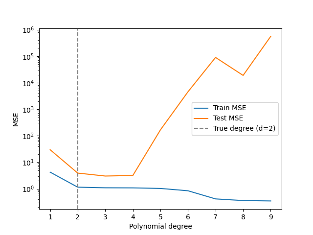

The train MSE curve is monotonically decreasing; the test MSE curve has a U-shape with its minimum near the true degree 2.

*** Ridge regression: shrinking coefficients

Ridge regression adds a squared-coefficient penalty to the OLS objective:

\[
\hat\beta_{\text{ridge}} = \arg\min_\beta \frac{1}{n}\|y - X\beta\|^2 + \lambda \sum_{j=1}^{p} \beta_j^2
\]

The first-order condition gives the closed-form solution

\[
\hat\beta_{\text{ridge}} = \left(\frac{X^\top X}{n} + \lambda \Lambda\right)^{-1} \frac{X^\top y}{n}
\]

where $\Lambda = \operatorname{diag}(0, 1, 1, \ldots, 1)$ so the intercept is not penalized. With $\lambda = 0$ this coincides with the OLS estimate.

Before fitting, we standardize the polynomial features (not the intercept column) so that $\lambda$ treats all predictors equally regardless of their natural scale.

#+begin_src python :results output
# Standardise columns 1..d using training mean/std
def standardize(Xraw, mean=None, std=None):
    if mean is None:
        mean = Xraw[:, 1:].mean(axis=0)
        std  = Xraw[:, 1:].std(axis=0) + 1e-8
    Xs = Xraw.copy()
    Xs[:, 1:] = (Xs[:, 1:] - mean) / std
    return Xs, mean, std

d = 9   
Xtr_raw = poly_features(x_train, d)
Xte_raw = poly_features(x_test,  d)

Xtr, fmean, fstd = standardize(Xtr_raw)
Xte, _,    _     = standardize(Xte_raw, fmean, fstd)

def ridge(X, y, lam):
    n, p = X.shape
    Lambda = np.diag([0.0] + [1.0] * (p - 1))
    A = X.T @ X / n + lam * Lambda
    return np.linalg.solve(A, X.T @ y / n)

for lam in [0.0, 0.5, 1.0, 2.0]:
    b = ridge(Xtr, y_train, lam)
    mse_tr = np.mean((y_train - Xtr @ b) ** 2)
    mse_te = np.mean((y_test  - Xte @ b) ** 2)
    print(f"lambda={lam:.1f}  train MSE={mse_tr:.2f}  test MSE={mse_te:.2f}")
#+end_src

#+RESULTS:
: lambda=0.0  train MSE=0.35  test MSE=555215.25
: lambda=0.5  train MSE=1.36  test MSE=6.73
: lambda=1.0  train MSE=1.51  test MSE=9.81
: lambda=2.0  train MSE=1.72  test MSE=11.86

Ridge shrinks all coefficients continuously but never sets any exactly to zero.

*** Lasso regression: coordinate descent and sparsity

The lasso uses an $L_1$ penalty:

\[
\hat\beta_{\text{lasso}} = \arg\min_\beta \frac{1}{2n}\|y - X\beta\|^2 + \lambda \sum_{j=1}^{p} |\beta_j|
\]

There is no closed-form solution. The single-coordinate minimizer involves the /soft-thresholding/ operator

\[
S(z, \lambda) = \operatorname{sign}(z) \cdot \max(|z| - \lambda,\, 0)
\]

which sets the coefficient to zero whenever $|z| < \lambda$.

Starting from the coordinate-wise objective:

$$\min_{\beta_j} \frac{1}{2n}\|r_j - X_j \beta_j\|^2 + \lambda|\beta_j|$$

with $r_j = y - \sum_{k \neq j} X_k \beta_k$

Expanding the quadratic term:

$$\frac{1}{2n}\left(r_j^T r_j - 2\beta_j X_j^T r_j + \beta_j^2 X_j^T X_j\right) + \lambda|\beta_j|$$

Taking the derivative of the smooth part:

$$\frac{\partial}{\partial \beta_j} = \frac{1}{n}\left(-X_j^T r_j + \beta_j X_j^T X_j\right)$$

The first order condition for the full objective is:

$$\frac{1}{n}\left(-X_j^T r_j + \beta_j X_j^T X_j\right) + \lambda \partial|\beta_j| = 0$$

where the notation $\partial|\beta_j|$ is short-hand for the following "derivative":

$$\partial|\beta_j| = \begin{cases} \{1\} & \beta_j > 0 \\ \{-1\} & \beta_j < 0 \\ [-1, 1] & \beta_j = 0 \end{cases}$$

Letting $z_j = X_j^T r_j / n$ and $c_j = X_j^T X_j / n$, the three cases resolve to:

$$\hat{\beta}_j = \begin{cases} \frac{z_j - \lambda}{c_j} & z_j > \lambda \\ \frac{z_j + \lambda}{c_j} & z_j < -\lambda \\ 0 & |z_j| \leq \lambda \end{cases}$$

Which is exactly the soft-threshold formula:

$$\hat{\beta}_j = \frac{S(z_j, \lambda)}{c_j}$$


#+begin_src python :results output
def soft_threshold(z, threshold):
    return np.sign(z) * np.maximum(np.abs(z) - threshold, 0.0)

def lasso_cd(X, y, lam, max_iter=3000, tol=1e-8):
    n, p = X.shape
    beta = np.zeros(p)
    col_norms = np.sum(X ** 2, axis=0) / n   # yields the c_j
    for _ in range(max_iter):
        beta_old = beta.copy()
        for j in range(p):
            # Partial residual holding all other coefficients fixed
            r_j = y - X @ beta + X[:, j] * beta[j]
            z_j = X[:, j] @ r_j / n
            if j == 0:                        # intercept: no penalty
                beta[j] = z_j / col_norms[j]
            else:
                beta[j] = soft_threshold(z_j, lam) / col_norms[j]
        if np.max(np.abs(beta - beta_old)) < tol:
            break
    return beta

for lam in [0.0, 0.5, 1.0, 2.0]:
    b = lasso_cd(Xtr, y_train, lam)
    n_zeros = np.sum(np.abs(b[1:]) < 1e-6)
    mse_te = np.mean((y_test - Xte @ b) ** 2)
    print(f"lambda={lam:.1f}  zeros={n_zeros}/9  test MSE={mse_te:.2f}")
#+end_src

#+RESULTS:
: lambda=0.0  zeros=0/9  test MSE=367.49
: lambda=0.5  zeros=7/9  test MSE=5.01
: lambda=1.0  zeros=7/9  test MSE=3.73
: lambda=2.0  zeros=8/9  test MSE=7.67

Lasso sets coefficients exactly to zero (sparse solution) because the $L_1$ penalty has a kink at zero: any coefficient smaller than $\lambda$ in magnitude is thresholded all the way to zero. This makes lasso a natural tool for variable selection. Ridge, which uses a smooth $L_2$ penalty, shrinks coefficients (in absolute value) but does not set them equal to zero.

*** Tuning $\lambda$ with cross-validation

The hyper-parameter $\lambda$ controls the bias-variance trade-off. We choose it by $k$ fold cross-validation: split the training data into $k$ equal folds; in each iteration use $k-1$ folds to fit the model and the remaining fold to evaluate the loss. The average validation loss across folds estimates out-of-sample performance without ever touching the test set.

When you will use $k$ fold cross validation in your own analyses, you will probably use [[https://scikit-learn.org/stable/modules/generated/sklearn.model_selection.KFold.html][scikit-learn KFold]]. Here we program the $k$ folds ourselves with =numpy=. Read the code for the function =kfold_cv= and try to understand how this works (you can ask an LLM for help, if necessary).

#+begin_src python :results graphics file output :file ./figures/cross_validation_lasso_ridge.png
def kfold_cv(X, y, lam_values, k=5, method="ridge"):
    n = len(y)
    fold_size = n // k # integer division
    val_mse = np.zeros(len(lam_values))
    for fold in range(k):
        idx_val   = np.arange(fold * fold_size, (fold + 1) * fold_size)
        idx_train = np.concatenate([np.arange(0, fold * fold_size),
                                    np.arange((fold + 1) * fold_size, n)])
        Xf_tr, yf_tr   = X[idx_train], y[idx_train]
        Xf_val, yf_val = X[idx_val],   y[idx_val]
        for i, lam in enumerate(lam_values):
            if method == "ridge":
                b = ridge(Xf_tr, yf_tr, lam)
            else:
                b = lasso_cd(Xf_tr, yf_tr, lam)
            val_mse[i] += np.mean((yf_val - Xf_val @ b) ** 2)
    return val_mse / k

lam_values = np.linspace(0.05, 3.0, 61)
cv_ridge = kfold_cv(Xtr, y_train, lam_values, k=5, method="ridge")
cv_lasso = kfold_cv(Xtr, y_train, lam_values, k=5, method="lasso")

opt_ridge = lam_values[np.argmin(cv_ridge)]
opt_lasso = lam_values[np.argmin(cv_lasso)]

plt.plot(lam_values, cv_ridge, label="Ridge CV MSE")
plt.plot(lam_values, cv_lasso, label="Lasso CV MSE")
plt.axvline(opt_ridge, linestyle="--", color="steelblue",  alpha=0.6, label="optimal $\\lambda$ ridge")
plt.axvline(opt_lasso, linestyle="--", color="forestgreen", alpha=0.6, label="optimal $\\lambda$ lasso")
plt.xlabel("lambda"); plt.ylabel("Validation MSE")
plt.legend()
#+end_src

#+RESULTS:
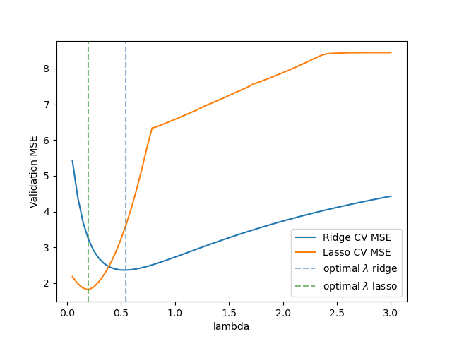

Both curves have a U-shape: too small $\lambda$ leads to over-fitting; too large leads to under-fitting. The optimal $\lambda$ sits at the bottom of the U. Because we only have $k=5$ folds on 20 training points (4 per fold), the validation estimates are noisy; with more data the U becomes smoother and the optimum sharper.

*** Bias--variance decomposition

Assume the true relationship is $y = f(x) + \varepsilon$, where
$\varepsilon \sim (0, \sigma^2)$ is independent noise. Let $\hat{y}$
be our estimator. We want to compute the expected squared error at a
fixed point $x$:

\begin{align*}
\mathbb{E}\!\left[(y - \hat{y})^2\right]
&= \mathbb{E}\!\left[(f(x) + \varepsilon - \hat{y})^2\right] \\
&= \mathbb{E}\!\left[((f(x) - \hat{y}) + \varepsilon)^2\right] \\
&= \mathbb{E}\!\left[(f(x) - \hat{y})^2\right]
 + 2\,\mathbb{E}\!\left[(f(x) - \hat{y})\,\varepsilon\right]
 + \mathbb{E}\!\left[\varepsilon^2\right].
\end{align*}

Since $\varepsilon$ is independent of $\hat{y}$ and
$\mathbb{E}[\varepsilon] = 0$, the cross term vanishes:
\[
\mathbb{E}\!\left[(f(x) - \hat{y})\,\varepsilon\right]
= \mathbb{E}\!\left[f(x) - \hat{y}\right]\mathbb{E}[\varepsilon] = 0,
\]
and $\mathbb{E}[\varepsilon^2] = \sigma^2$. So:
\[
\mathbb{E}\!\left[(y - \hat{y})^2\right]
= \mathbb{E}\!\left[(f(x) - \hat{y})^2\right] + \sigma^2.
\]

Now we decompose the first term. Let
$\mu = \mathbb{E}[\hat{y}]$. Add and subtract $\mu$:

\begin{align*}
\mathbb{E}\!\left[(f(x) - \hat{y})^2\right]
&= \mathbb{E}\!\left[(f(x) - \mu + \mu - \hat{y})^2\right] \\
&= \mathbb{E}\!\left[(f(x) - \mu)^2
  + 2(f(x)-\mu)(\mu - \hat{y})
  + (\mu - \hat{y})^2\right] \\
&= (f(x) - \mu)^2
  + 2(f(x)-\mu)\,\mathbb{E}\!\left[\mu - \hat{y}\right]
  + \mathbb{E}\!\left[(\hat{y} - \mu)^2\right].
\end{align*}

Since $\mathbb{E}[\mu - \hat{y}] = \mu - \mu = 0$, the cross term vanishes, leaving:

$$\mathbb{E}\!\left[(f(x) - \hat{y})^2\right] = \underbrace{(f(x) - \mu)^2}_{\text{Bias}^2} + \underbrace{\mathbb{E}\!\left[(\hat{y}-\mu)^2\right]}_{\operatorname{Var}(\hat{y})}.$$

Combining everything the expected test error decomposes into three terms:

\[
\mathbb{E}\!\left[(y - \hat{y})^2\right] = \underbrace{\left(\mathbb{E}[\hat{y}] - f(x)\right)^2}_{\text{Bias}^2} + \underbrace{\operatorname{Var}(\hat{y})}_{\text{Variance}} + \underbrace{\sigma^2}_{\text{Irreducible noise}}
\]

- /Bias/: how far the average prediction is from the truth. A too-simple model (underfitting) has high bias.
- /Variance/: how much the prediction changes across different training samples. A too-complex model (overfitting) has high variance.
- /Irreducible noise/: $\sigma^2$, the noise in $y$ itself. No model can remove it.

Regularisation trades bias for variance: as $\lambda$ increases, bias rises (the model is forced toward zero) but variance falls (the model is less sensitive to the particular training sample). The optimal $\lambda$ balances the two.

We can verify this decomposition empirically by repeating the experiment many times with different training samples and observing the average squared bias and variance of the predictions.

#+begin_src python :results graphics file output :file ./figures/bias_variance_tradeoff.png
fig, axes = plt.subplots(1, 3, figsize=(15, 5))

N_sim  = 500
x_grid = np.linspace(-1.0, 1.0, 80)
degrees = [1, 5, 9]

for ax, d in zip(axes, degrees):
    all_preds = np.zeros((N_sim, len(x_grid)))
    for i in range(N_sim):
        xi = np.sort(rng.uniform(-2.0, 2.0, n_train))
        yi = 1.0 + 2.0 * xi ** 2 + rng.normal(0, 1.5, n_train)
        coeffs_i = np.polyfit(xi, yi, d)
        all_preds[i] = np.polyval(coeffs_i, x_grid)

    f_true    = 1.0 + 2.0 * x_grid ** 2
    mean_pred = all_preds.mean(axis=0)
    bias_sq   = (mean_pred - f_true) ** 2
    variance  = all_preds.var(axis=0)

    ax.plot(x_grid, bias_sq,            label="Bias²")
    ax.plot(x_grid, variance,           label="Variance")
    ax.plot(x_grid, bias_sq + variance, label="Bias² + Variance", lw=2)
    ax.set_xlabel("x")
    ax.set_ylabel("MSE component")
    ax.set_title(f"Degree-{d} polynomial")
    ax.legend()

fig.suptitle("Bias–Variance Decomposition", fontsize=14)
plt.tight_layout()
#+end_src

#+RESULTS:
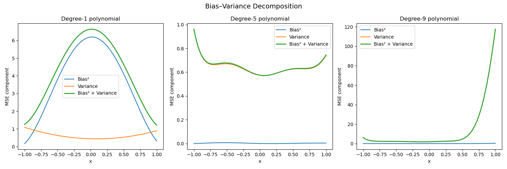

Compare the total $\text{Bias}^{2}$ + Variance across degrees 1, 5 and 9 to trace the full bias--variance trade-off curve. At degree 1 bias is large; at degree 9 variance dominates.

*** Why lasso gives sparsity but ridge does not

Both penalties shrink coefficients toward zero, but only lasso can set them /exactly/ to zero. The reason is geometric.

Consider minimising the OLS loss subject to a budget constraint on the coefficients:

- /Ridge/ constrains $\|\beta\|_2^2 = \beta_1^2 + \beta_2^2 \leq c$. The constraint region is a smooth circle (sphere in higher dimensions). The loss contours (ellipses) typically touch the constraint region on its curved surface, away from the axes, so both coefficients are non-zero.
- /Lasso/ constrains $\|\beta\|_1 = |\beta_1| + |\beta_2| \leq c$. The constraint region is a diamond with corners on the axes. The loss contours are much more likely to first touch the diamond at a corner, where one coefficient is exactly zero.

We can visualise this in 2D.

#+begin_src python :results graphics file output :file ./figures/lasso_to_zero.png
theta = np.linspace(0, 2 * np.pi, 300)
fig, axes = plt.subplots(1, 2, figsize=(10, 4.5))

# OLS contours (loss ellipses centred away from origin)
beta_ols_2d = np.array([1.2, 0.8])    # hypothetical OLS solution
A2 = np.array([[2.0, 0.5], [0.5, 1.0]])   # positive definite quadratic form

b1, b2 = np.meshgrid(np.linspace(-1.5, 2.0, 200), np.linspace(-1.5, 1.5, 200))
beta_grid = np.stack([b1, b2], axis=-1)
diff = beta_grid - beta_ols_2d
loss_2d = np.einsum("...i,ij,...j->...", diff, A2, diff)

for ax, title, constraint in zip(axes, ["Ridge (L2)", "Lasso (L1)"], ["L2", "L1"]):
    ax.contour(b1, b2, loss_2d, levels=10, cmap="Blues_r", alpha=0.7)
    if constraint == "L2":
        ax.fill(np.cos(theta), np.sin(theta), alpha=0.3, color="steelblue")
        ax.plot(np.cos(theta), np.sin(theta), color="steelblue", lw=2)
    else:
        diamond = np.array([[1,0],[0,1],[-1,0],[0,-1],[1,0]])
        ax.fill(diamond[:,0], diamond[:,1], alpha=0.3, color="forestgreen")
        ax.plot(diamond[:,0], diamond[:,1], color="forestgreen", lw=2)
    ax.axhline(0, color="gray", lw=0.8); ax.axvline(0, color="gray", lw=0.8)
    ax.set_xlabel(r"$\beta_1$"); ax.set_ylabel(r"$\beta_2$")
    ax.set_title(title); ax.set_xlim(-1.6, 2.1); ax.set_ylim(-1.6, 1.6)

plt.tight_layout()
#+end_src

#+RESULTS:
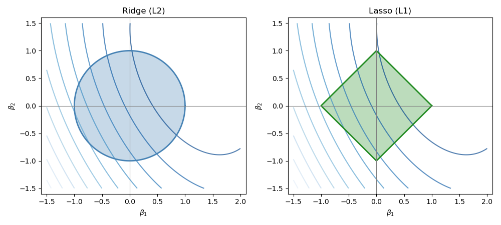

The corner of the lasso diamond lies on the $\beta_2 = 0$ axis: wherever the OLS solution points from that corner, the unconstrained minimizer must cross the horizontal axis, making it likely that the constrained solution lands exactly there with $\beta_2 = 0$.

*** Regularisation path

The /regularisation path/ shows how each coefficient changes as $\lambda$ varies from zero (OLS) to a large value (strong shrinkage). It helps identify which variables are most important: lasso paths hit zero at different $\lambda$ values, effectively ordering variables by their relevance.

#+begin_src python :results graphics file output :file ./figures/regularisation_path.png
lam_path   = np.logspace(-2, 1, 60)   # from 0.01 to 10 on a log scale
ridge_coefs = np.array([ridge(Xtr, y_train, l)[1:] for l in lam_path])
lasso_coefs = np.array([lasso_cd(Xtr, y_train, l)[1:] for l in lam_path])

fig, (ax1, ax2) = plt.subplots(1, 2, figsize=(12, 4))

for j in range(ridge_coefs.shape[1]):
    ax1.plot(lam_path, ridge_coefs[:, j])
ax1.set_xscale("log"); ax1.axhline(0, color="k", lw=0.8, ls="--")
ax1.set_xlabel("lambda (log scale)"); ax1.set_ylabel("Coefficient value")
ax1.set_title("Ridge regularisation path (all coefficients shrink smoothly)")

for j in range(lasso_coefs.shape[1]):
    ax2.plot(lam_path, lasso_coefs[:, j])
ax2.set_xscale("log"); ax2.axhline(0, color="k", lw=0.8, ls="--")
ax2.set_xlabel("lambda (log scale)"); ax2.set_ylabel("Coefficient value")
ax2.set_title("Lasso regularisation path (coefficients hit zero at different lambda)")

plt.tight_layout()
#+end_src

#+RESULTS:
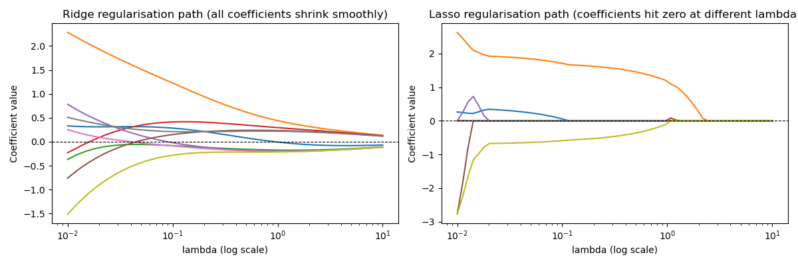

In the ridge path all curves approach zero asymptotically but never reach it. In the lasso path curves bend sharply and hit zero at specific $\lambda$ values. The last variable to reach zero is the most important predictor according to lasso.

*** Information criteria

An alternative to cross-validation that you may find in the literature is an /information criterion/: penalize the log-likelihood (or equivalently the in-sample fit) for model complexity directly, without holding out data. Two common choices are:

- /AIC/: $\text{AIC} = n \log(\text{RSS}/n) + 2k$
- /BIC/: $\text{BIC} = n \log(\text{RSS}/n) + k \log n$

where $k$ is the number of parameters and RSS is the residual sum of squares. BIC penalizes model size more heavily (by $\log n$ instead of 2) and tends to select simpler models.

Information criteria are fast to compute (no refitting needed) but assume the model is correctly specified. Cross-validation makes fewer assumptions and is preferred when data are plentiful.

#+begin_src python :results output
def aic(y_train, y_pred_train, k):
    n   = len(y_train)
    rss = np.sum((y_train - y_pred_train) ** 2)
    return n * np.log(rss / n) + 2 * k

def bic(y_train, y_pred_train, k):
    n   = len(y_train)
    rss = np.sum((y_train - y_pred_train) ** 2)
    return n * np.log(rss / n) + k * np.log(n)

degrees = range(1, 10)
aic_vals, bic_vals = [], []
for d in degrees:
    Xtr_d = poly_features(x_train, d)
    b = ols(Xtr_d, y_train)
    k = d + 1                          # number of free parameters
    aic_vals.append(aic(y_train, Xtr_d @ b, k))
    bic_vals.append(bic(y_train, Xtr_d @ b, k))

opt_aic = list(degrees)[np.argmin(aic_vals)]
opt_bic = list(degrees)[np.argmin(bic_vals)]
print(f"AIC selects degree {opt_aic},  BIC selects degree {opt_bic}")
#+end_src

#+RESULTS:
: AIC selects degree 8,  BIC selects degree 7

#+begin_src python :results graphics file output :file ./figures/AIC_BIC.png
plt.plot(degrees, aic_vals, "o-", label=f"AIC (min at d={opt_aic})")
plt.plot(degrees, bic_vals, "s-", label=f"BIC (min at d={opt_bic})")
plt.axvline(2, color="gray", ls="--", label="True degree")
plt.xlabel("Polynomial degree"); plt.ylabel("Information criterion")
plt.legend()
#+end_src

#+RESULTS:
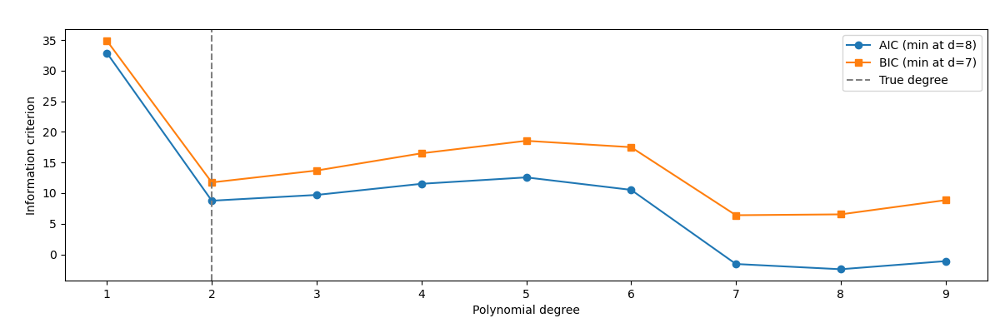

Both criteria should select a degree close to the true value of 2. BIC will generally prefer an equal or lower degree than AIC because its penalty grows with $n$.

** Summary

- /Over-fitting/ occurs when a model is so complex that it fits training-sample noise rather than the true data-generating process. Adding polynomial terms always reduces training MSE but eventually increases test MSE.
- A /train/test split/ reveals over-fitting: if test MSE is much larger than train MSE the model has over-fit. The test set should be used only once to evaluate the final model.
- /Ridge regression/ adds a squared-coefficient penalty $\lambda \|\beta\|_2^2$ to the OLS objective. Its closed-form solution $\hat\beta = (X^\top X/n + \lambda\Lambda)^{-1}X^\top y/n$ shrinks all coefficients toward zero without setting any exactly to zero.
- /Lasso regression/ adds an absolute-value penalty $\lambda \|\beta\|_1$ which can be solved by coordinate descent. The /soft-thresholding/ operator sets small coefficients exactly to zero, performing automatic variable selection. A useful rule of thumb: lasso selects at most as many variables as there are observations.
- The hyper-parameter $\lambda$ is chosen by $k$ fold cross-validation, which estimates out-of-sample performance by rotating which fold is held out for validation.

** Review Questions

--------------------

#+BEGIN_EXPORT latex
\newpage
#+END_EXPORT
* Lecture 5: Neural network
:PROPERTIES:
:CUSTOM_ID: lecture-neural-network
:header-args:  :session *lecture_nn* :python ~/my_env/tf_env/bin/python3 :async t  :results output :exports both
:END:

**Skills you learn in this lecture:** program a neural network and the effects of hyper-parameter choices like the number of hidden layers, nodes per layer, activation function, epochs, learning rate; identify over-fitting and under-fitting.

** Learning Objectives
:PROPERTIES:
:CUSTOM_ID: lecture5-learning-objectives
:END:

After this lecture you will be able to:
- Describe the architecture of a feedforward neural network with input, hidden, and output layers.
- Implement forward propagation from scratch using matrix multiplication.
- Derive and implement the backpropagation algorithm using the chain rule.
- Explain the role of activation functions (ReLU, sigmoid, tanh, softmax) and choose between them.
- Identify over-fitting and under-fitting from train and test accuracy.
- Translate a numpy neural network into TensorFlow code using =tf.GradientTape=.
- Build the same model concisely using the Keras Sequential API.

** Introduction
:PROPERTIES:
:CUSTOM_ID: lecture5-introduction
:END:

In lectures 3 and 4 we saw that OLS, ridge, and lasso all fit a linear model. Increasing the polynomial degree adds flexibility but risks over-fitting; regularization trades off bias against variance to control the over-fitting risk.

Neural networks take this logic further. Instead of manually specifying a feature transformation ($x, x^2, x^3, \ldots$), the network /learns/ the transformation from data. Each hidden layer applies a learnable linear map followed by a nonlinear activation function, stacking simple computations to represent surprisingly complex relationships.

For this lecture we move from regression to *classification* using the Iris dataset: 150 measurements of four flower features (sepal length, sepal width, petal length, petal width) for three species -- /setosa/, /versicolor/, and /virginica/. The goal is to predict species from measurements.

A neural network with one or two hidden layers solves this problem well. We vary hyper-parameters like the number of hidden layers, epochs, learning rate, and activation function in the interactive app to see what the effects are on the model's prediction.

#+caption: Neural network for the Iris dataset
#+attr_latex: scale=0.3
#+name: fig:NeuralNetworkIris
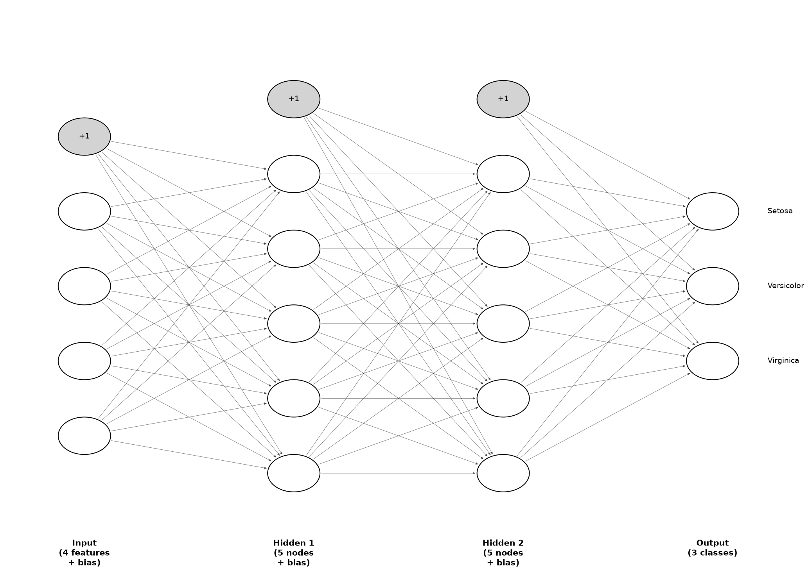

Figure ref:fig:NeuralNetworkIris illustrates the neural network that the app works with. The input layer (left of the figure) has 4 nodes (the four flower features mentioned above) and a bias term (comparable to a constant in an OLS regression) denoted by the $+1$ grey node at the top. Hidden layer 1 has 5 nodes and a bias node. Each line represents a coefficient. That is, a node in the hidden layer receives input from each of the 4 input features plus the bias. This input is of the form $w^T x + b$ where $x$ denotes a vector with the 4 measurements of flower features and $b$ the bias (constant) term. This input is transformed using an activation function to which we return below. The coefficients $w$ and $b$ are referred to as weights. The goal is to estimate the weights of the neural network.

With this vector multiplication, bias and activation function each of the nodes in the hidden layer has a value. Then we do the same again (vector multiplication, bias, activation) as inputs for the second hidden layer. Note that the bias term in the first hidden layer has no line going into it (the constant does not depend on the values from the input layer) but does affect the values of the second hidden layer.

Finally, we do the same from the second layer to the output layer. We use a Softmax function to determine the 3 probabilities that the measurements $x_1 ... x_4$ belong to a Setosa, Versicolor or Virginica iris.

In the app you can choose between three activation functions which are illustrated in Figure ref:fig:ActivationFunctions. We come back to these functions below. In the app, the Softmax function takes in a vector with three values and turn these into three probabilities: that is, each value is between 0 and 1 and adding the three values gives 1.


#+caption: Three activation functions
#+attr_latex: scale=0.3
#+name: fig:ActivationFunctions
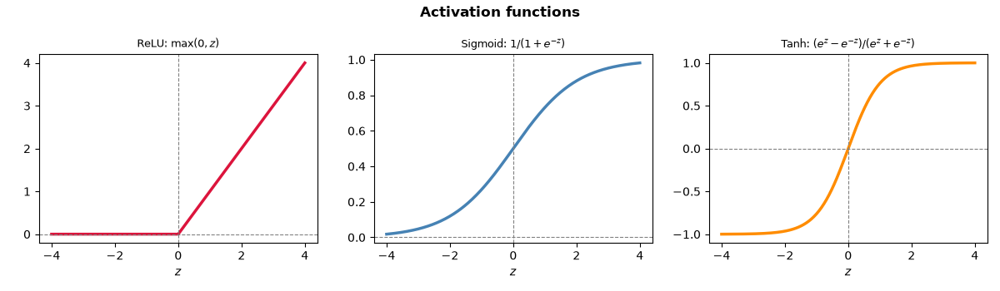


The app also allows you to choose two hyper-parameters: the number of epochs and the learning rate. Recall that hyper-parameters are parameters that affect the estimation algorithm but are not estimated themselves; they are "tuned". The number of epochs refers to the number of times an observation is used in estimation. Training typically requires multiple epochs because a single pass is rarely sufficient for the model to learn complex patterns. Each subsequent epoch allows the model to refine its accuracy and generalize better to unseen data. Tuning the number of epochs is finding the right balance: too few can lead to under-fitting (the model hasn't learned enough), while too many can cause over-fitting (the model memorizes the training data and fails to generalize).

The learning rate specifies to which extent parameters change given that a change improves the fit (reduces the loss) of the estimation. If the learning rate is too low, it takes a lot of time before the algorithm converges to the parameter values that minimize the loss. If the learning rate is too high, parameters may over-shoot their optimal value and sometimes the algorithm does not converge at all.


*** code figure neural network python :noexport:


#+begin_src python
import matplotlib.pyplot as plt
import matplotlib.patches as mpatches

def draw_neural_net(ax, left, right, bottom, top, layer_sizes):
    n_layers = len(layer_sizes)
    bias_layers = [0, 1, 2]
    
    v_spacing = (top - bottom) / float(max(layer_sizes) + 1)
    h_spacing = (right - left) / float(n_layers - 1)
    node_radius = v_spacing / 4.
    
    node_positions = []
    
    for n, layer_size in enumerate(layer_sizes):
        has_bias = n in bias_layers
        total_nodes = layer_size + (1 if has_bias else 0)
        layer_top = v_spacing * (total_nodes - 1) / 2. + (top + bottom) / 2.
        positions = []
        
        # Draw bias node first (at top)
        if has_bias:
            bx = n * h_spacing + left
            by = layer_top
            circle = plt.Circle((bx, by), node_radius,
                                 color='lightgrey', ec='k', zorder=4)
            ax.add_artist(circle)
            ax.text(bx, by, '+1', ha='center', va='center',
                    fontsize=9, zorder=5)
            positions.append((bx, by, True))
            layer_top -= v_spacing
        
        # Draw regular nodes
        for m in range(layer_size):
            cx = n * h_spacing + left
            cy = layer_top - m * v_spacing
            circle = plt.Circle((cx, cy), node_radius,
                                 color='white', ec='k', zorder=4)
            ax.add_artist(circle)
            positions.append((cx, cy, False))
        
        node_positions.append(positions)
    
    # Draw arrows between layers
    for n in range(len(layer_sizes) - 1):
        for (x1, y1, _) in node_positions[n]:
            for (x2, y2, is_bias) in node_positions[n+1]:
                if is_bias:
                    continue
                # Compute direction vector
                import numpy as np
                dx = x2 - x1
                dy = y2 - y1
                dist = np.sqrt(dx**2 + dy**2)
                # Shorten start and end by node_radius so arrow touches circle edge
                ux, uy = dx / dist, dy / dist
                start_x = x1 + ux * node_radius
                start_y = y1 + uy * node_radius
                end_x   = x2 - ux * node_radius
                end_y   = y2 - uy * node_radius

                ax.annotate("",
                    xy=(end_x, end_y),
                    xytext=(start_x, start_y),
                    arrowprops=dict(
                        arrowstyle="-|>",
                        color='k',
                        lw=0.5,
                        mutation_scale=6,  # arrowhead size
                        alpha=0.5
                    ),
                    zorder=3
                )
    
    # Layer labels
    labels = ['Input\n(4 features\n+ bias)', 
              'Hidden 1\n(5 nodes\n+ bias)', 
              'Hidden 2\n(5 nodes\n+ bias)', 
              'Output\n(3 classes)']
    
    for n, label in enumerate(labels):
        ax.text(n * h_spacing + left, bottom - 0.05, label,
                ha='center', va='top', fontsize=10, fontweight='bold')
    
    # Output node labels (iris classes)
    iris_labels = ['Setosa', 'Versicolor', 'Virginica']
    for i, (x, y, _) in enumerate(node_positions[-1]):
        ax.text(x + 0.07, y, iris_labels[i], ha='left', va='center', fontsize=9)


fig = plt.figure(figsize=(14, 10))
ax = fig.gca()
ax.axis('off')
ax.set_xlim(0, 1)
ax.set_ylim(0, 1)

draw_neural_net(ax, .1, .9, .1, .9, [4, 5, 5, 3])

plt.tight_layout()
fig.savefig('./figures/nn.png', dpi=150, bbox_inches='tight')
#+end_src


** App
:PROPERTIES:
:CUSTOM_ID: lecture5-app
:END:

Train a feedforward neural network on the Iris dataset and explore how architecture and hyper-parameters affect train versus test accuracy.  Choose two features for the scatter plot axes: filled circles are correctly classified flowers; open circles are misclassified ones.  The confusion matrices show, for each true species, how many observations were predicted as each class.

#+BEGIN_EXPORT html
<div style="text-align:center;margin:20px 0;">
  <a href="https://janboone.github.io/datascience-marimo/lecture5_iris_nn.html"
     target="_blank"
     style="background:#1f3c88;color:white;padding:12px 24px;border-radius:6px;text-decoration:none;font-weight:bold;font-size:1em;">
    &#9654; Open app: Iris neural network
  </a>
</div>
#+END_EXPORT

** Python Code Explanation
:PROPERTIES:
:CUSTOM_ID: lecture5-python-code
:END:

*** The iris dataset
:PROPERTIES:
:CUSTOM_ID: lecture5-iris-data
:END:

The Iris dataset is one of the most studied datasets in machine learning.  It contains 150 observations: 50 each of /Iris setosa/, /Iris versicolor/, and /Iris virginica/.  Each observation records four continuous measurements in centimetres:

| Feature      | Description         |
|--------------+---------------------|
| Sepal length | Length of the sepal |
| Sepal width  | Width of the sepal  |
| Petal length | Length of the petal |
| Petal width  | Width of the petal  |

The three species appear in order in the raw data (rows 1--50 setosa, 51--100 versicolor, 101--150 virginica), so we shuffle before splitting into train and test sets.  We normalize features by z-scoring: subtracting the training mean and dividing by the training standard deviation.  This ensures that all four features enter the network on a comparable scale, which stabilizes gradient descent. We also use the training mean and standard deviation to normalize the test data.

Using the dictionary =species_map= and the =map= function we turn the names (strings) into integers 0, 1, 2. 

#+BEGIN_SRC python 
import numpy as np
import pandas as pd
from sklearn.model_selection import train_test_split

cols = ["sepal_length", "sepal_width", "petal_length", "petal_width", "species"]
iris = pd.read_csv('./data/iris_data.csv', names=cols)

species_map = {"Iris-setosa": 0, "Iris-versicolor": 1, "Iris-virginica": 2}
iris["label"] = iris["species"].map(species_map)

X = iris[["sepal_length", "sepal_width", "petal_length", "petal_width"]].values
y = iris["label"].values

# 80/20 split, shuffled
X_tr_raw, X_te_raw, y_train, y_test = train_test_split(
    X, y, test_size=0.2, random_state=0, shuffle=True
)

# Z-score normalisation: fit on training set, apply to both sets
mu  = X_tr_raw.mean(axis=0)
sig = X_tr_raw.std(axis=0)
X_train = (X_tr_raw - mu) / sig
X_test  = (X_te_raw - mu) / sig

print(f"Training: {len(X_train)} samples,  Test: {len(X_test)} samples")
print(f"Feature means  (train): {np.round(mu,  2)}")
print(f"Feature stds   (train): {np.round(sig, 2)}")
print(f"Class counts   (train): {np.bincount(y_train)}")
#+END_SRC

: Training: 120 samples,  Test: 30 samples
: Feature means  (train): [5.88 3.05 3.82 1.23]
: Feature stds   (train): [0.85 0.43 1.78 0.77]
: Class counts   (train): [39 37 44]


*** Activation functions
:PROPERTIES:
:CUSTOM_ID: lecture5-activation-functions
:END:

Each hidden layer applies a linear transformation followed by a nonlinear /activation function/ $\sigma(\cdot)$.  Without nonlinearity, stacking layers would still produce a linear model.  The output layer uses /softmax/, which converts raw scores into class probabilities.

*Hidden-layer activations*

| Function | Formula                             | Range     | Property                               |
|----------+-------------------------------------+-----------+----------------------------------------|
| ReLU     | $\max(0, z)$                        | $[0, \infty)$  | Fast; sparse; most popular in practice |
| Sigmoid  | $\frac{1}{1+e^{-z}}$                | $(0, 1)$  | Saturates for large $z$                |
| Tanh     | $\frac{e^z - e^{-z}}{e^z + e^{-z}}$ | $(-1, 1)$ | Zero-centred; also saturates           |

*Output-layer activation: softmax*

For a $K$-class problem the softmax converts a vector of $K$ raw scores $(z_1, \ldots, z_K)$ into probabilities:

$$\hat{y}_k = \frac{e^{z_k}}{\sum_{j=1}^K e^{z_j}}, \qquad k = 1, \ldots, K.$$

All $\hat{y}_k \geq 0$ and they sum to one, so they can be interpreted as class probabilities.

*Cross-entropy loss*

We minimise the average negative log-probability of the true class:

$$L = -\frac{1}{n} \sum_{i=1}^n \log \hat{y}_{y_i},$$

where $\hat{y}_{y_i}$ is the predicted probability for observation $i$'s true class $y_i$.  When $\hat{y}_{y_i} \to 1$ (correct and confident) the loss $\to 0$; when $\hat{y}_{y_i} \to 0$ the loss $\to \infty$.


#+BEGIN_SRC python :results graphics file output :file ./figures/lecture5_activations.png
import numpy as np
import matplotlib.pyplot as plt

z = np.linspace(-4, 4, 300)

def relu(z):    return np.maximum(0, z)
def sigmoid(z): return 1 / (1 + np.exp(-z))
def tanh_fn(z): return np.tanh(z)

# Softmax for 3 classes: vary z_1, fix z_2=0, z_3=-z_1
Z3 = np.column_stack([z, np.zeros_like(z), -z])
E  = np.exp(Z3 - Z3.max(axis=1, keepdims=True))

fig, axes = plt.subplots(1, 3, figsize=(12, 3.5))
fns    = [relu, sigmoid, tanh_fn]
labels = [r"ReLU: $\max(0,z)$",
          r"Sigmoid: $1/(1+e^{-z})$",
          r"Tanh: $(e^z-e^{-z})/(e^z+e^{-z})$"]
colors = ["crimson", "steelblue", "darkorange"]

for ax, fn, label, color in zip(axes, fns, labels, colors):
    ax.plot(z, fn(z), lw=2.5, color=color)
    ax.axhline(0, color="grey", lw=0.8, ls="--")
    ax.axvline(0, color="grey", lw=0.8, ls="--")
    ax.set_title(label, fontsize=9)
    ax.set_xlabel(r"$z$")

plt.suptitle("Activation functions", fontsize=12, fontweight="bold")
plt.tight_layout()
#+END_SRC

#+RESULTS:


The key difference between ReLU and sigmoid/tanh is that ReLU does not saturate for large positive values: its gradient is always 1 when $z > 0$.  Sigmoid and tanh both have near-zero slopes when $|z|$ is large, which causes the /vanishing gradient/ problem; layers receive very small gradient signals and learn slowly or not at all.

*** Neural network in numpy
:PROPERTIES:
:CUSTOM_ID: lecture5-numpy-nn
:END:

We now implement the full neural network in numpy using matrix notation.  The network has:
- Input layer: 4 features (one per iris measurement).
- $H$ hidden layers, each with 5 nodes.
- Output layer: 3 nodes (one per species), softmax activation.

Parameters are stored as a list of $[\mathbf{W}_k, \mathbf{b}_k]$ pairs.  For layer $k$ with $n_{\text{in}}$ inputs and $n_{\text{out}}$ outputs: weight matrix $\mathbf{W}_k \in \mathbb{R}^{n_{\text{in}} \times n_{\text{out}}}$ and bias $\mathbf{b}_k \in \mathbb{R}^{n_{\text{out}}}$.

*Initialisation.*  We use /He initialization/ for ReLU ($\sigma_W = \sqrt{2/n_{\text{in}}}$) and /Xavier initialization/ for sigmoid/tanh ($\sigma_W = \sqrt{1/n_{\text{in}}}$).  Weights that are too large cause exploding activations; too small causes vanishing gradients from the outset.

*Forward pass.*  For each layer $k$:

$$\mathbf{Z}_k = \mathbf{A}_{k-1} \mathbf{W}_k + \mathbf{b}_k, \qquad \mathbf{A}_k = \sigma(\mathbf{Z}_k),$$

where $\mathbf{A}_0 = \mathbf{X}$ (the input matrix, rows = observations) and $\sigma = $ softmax for the last layer.

*Backward pass.*  The combined gradient of the cross-entropy loss and the softmax at the output layer is:

$$\frac{\partial L}{\partial \mathbf{Z}_{\text{last}}} = \frac{\hat{\mathbf{Y}} - \mathbf{Y}}{n},$$

where $\mathbf{Y}$ is the one-hot encoded label matrix.  For each earlier layer $k$ we propagate backwards via the chain rule:

$$\frac{\partial L}{\partial \mathbf{W}_k} = \mathbf{A}_{k-1}^\top \frac{\partial L}{\partial \mathbf{Z}_k}, \qquad \frac{\partial L}{\partial \mathbf{Z}_{k-1}} = \left(\frac{\partial L}{\partial \mathbf{Z}_k} \mathbf{W}_k^\top\right) \odot \sigma'(\mathbf{Z}_{k-1}),$$

where $\odot$ denotes element-wise multiplication.  Parameters are updated by gradient descent:
$\mathbf{W}_k \leftarrow \mathbf{W}_k - \eta \frac{\partial L}{\partial \mathbf{W}_k}$ where $\eta > 0$ is called the learning rate.

#+BEGIN_SRC python :results output :exports both

# ── Activation functions ─────────────────────────────────────────────────────
def activate(Z, fn):
    if fn == "relu":    return np.maximum(0, Z)
    if fn == "sigmoid": return 1 / (1 + np.exp(-np.clip(Z, -40, 40)))
    return np.tanh(Z)

def activate_grad(Z, A, fn):
    if fn == "relu":    return (Z > 0).astype(float)
    if fn == "sigmoid": return A * (1 - A)
    return 1 - A ** 2

def softmax(Z):
    E = np.exp(Z - Z.max(axis=1, keepdims=True))
    return E / E.sum(axis=1, keepdims=True)

# ── Initialisation ────────────────────────────────────────────────────────────
def init_params(layer_sizes, fn, seed=42):
    rng = np.random.default_rng(seed)
    params = []
    for i in range(len(layer_sizes) - 1):
        scale = (np.sqrt(2 / layer_sizes[i]) if fn == "relu"
                 else np.sqrt(1 / layer_sizes[i]))
        W = rng.normal(0, scale, (layer_sizes[i], layer_sizes[i + 1]))
        b = np.zeros(layer_sizes[i + 1])
        params.append([W, b])
    return params

# ── Forward pass ──────────────────────────────────────────────────────────────
def forward(X, params, fn):
    As, Zs = [X], []
    for k, (W, b) in enumerate(params):
        Z = As[-1] @ W + b
        Zs.append(Z)
        A = activate(Z, fn) if k < len(params) - 1 else softmax(Z)
        As.append(A)
    return As, Zs

# ── Backward pass ─────────────────────────────────────────────────────────────
def backward(As, Zs, params, Y_oh, fn):
    n     = len(Y_oh)
    grads = []
    dZ    = (As[-1] - Y_oh) / n       # softmax + cross-entropy gradient
    for i in range(len(params) - 1, -1, -1):
        dW = As[i].T @ dZ
        db = dZ.sum(axis=0)
        grads.insert(0, (dW, db))
        if i > 0:
            dA = dZ @ params[i][0].T
            dZ = dA * activate_grad(Zs[i - 1], As[i], fn)
    return grads

# ── Training loop ─────────────────────────────────────────────────────────────
layer_sizes = [4, 5, 5, 3]            # two hidden layers of 5 nodes each
fn, lr      = "relu", 0.1
Y_oh        = np.eye(3)[y_train]
params      = init_params(layer_sizes, fn)
loss_hist   = []

for epoch in range(300):
    As, Zs = forward(X_train, params, fn)
    loss   = -np.mean(np.sum(Y_oh * np.log(As[-1] + 1e-12), axis=1))
    loss_hist.append(loss)
    grads  = backward(As, Zs, params, Y_oh, fn)
    for j, (dW, db) in enumerate(grads):
        params[j][0] -= lr * dW
        params[j][1] -= lr * db

# ── Evaluate ──────────────────────────────────────────────────────────────────
def predict(X):
    As, _ = forward(X, params, fn)
    return np.argmax(As[-1], axis=1)

train_acc = np.mean(predict(X_train) == y_train)
test_acc  = np.mean(predict(X_test)  == y_test)
print(f"Final cross-entropy loss: {loss_hist[-1]:.4f}")
print(f"Train accuracy:           {train_acc:.1%}")
print(f"Test  accuracy:           {test_acc:.1%}")
#+END_SRC

#+RESULTS:
: f1f9773a-ba5d-461c-89f7-60090f8c0baa


: Final cross-entropy loss: 0.0725
: Train accuracy:           96.7%
: Test  accuracy:           96.7%


*** Neural network in TensorFlow with GradientTape
:PROPERTIES:
:CUSTOM_ID: lecture5-tensorflow-nn
:END:

TensorFlow provides /automatic differentiation/: you specify only the forward pass inside a =tf.GradientTape()= context, and TensorFlow computes all gradients automatically.  This is more convenient than hand-coding backpropagation and scales to any architecture without modification.

The code below replicates the numpy network exactly -- same architecture, same He initialisation, same gradient-descent update -- but using TensorFlow variables and operations.

#+BEGIN_SRC python :results output :exports both
import tensorflow as tf

# ── Define weight variables ───────────────────────────────────────────────────
rng         = np.random.default_rng(42)
layer_sizes = [4, 5, 5, 3]
weights, biases = [], []
for i in range(len(layer_sizes) - 1):
    scale = np.sqrt(2 / layer_sizes[i])   # He initialisation
    W = tf.Variable(rng.normal(0, scale, (layer_sizes[i], layer_sizes[i+1])),
                    dtype=tf.float32)
    b = tf.Variable(tf.zeros(layer_sizes[i + 1]), dtype=tf.float32)
    weights.append(W)
    biases.append(b)

trainable_vars = weights + biases

# ── Forward pass using TensorFlow ops ────────────────────────────────────────
def forward_tf(X):
    A = tf.cast(X, tf.float32)
    for k in range(len(weights)):
        Z = A @ weights[k] + biases[k]
        A = tf.nn.relu(Z) if k < len(weights) - 1 else tf.nn.softmax(Z)
    return A

# ── Training with GradientTape ────────────────────────────────────────────────
optimizer  = tf.optimizers.SGD(learning_rate=0.1)
Y_oh_train = tf.one_hot(y_train, depth=3, dtype=tf.float32)
X_tr_tf    = tf.constant(X_train, dtype=tf.float32)

loss_hist_tf = []
for epoch in range(300):
    with tf.GradientTape() as tape:
        preds = forward_tf(X_tr_tf)
        loss  = -tf.reduce_mean(
            tf.reduce_sum(Y_oh_train * tf.math.log(preds + 1e-12), axis=1)
        )
    grads = tape.gradient(loss, trainable_vars)
    optimizer.apply_gradients(zip(grads, trainable_vars))
    loss_hist_tf.append(float(loss))

# ── Evaluate ──────────────────────────────────────────────────────────────────
preds_tr = np.argmax(forward_tf(tf.constant(X_train, dtype=tf.float32)), axis=1)
preds_te = np.argmax(forward_tf(tf.constant(X_test,  dtype=tf.float32)), axis=1)
print(f"Train accuracy: {np.mean(preds_tr == y_train):.1%}")
print(f"Test  accuracy: {np.mean(preds_te == y_test):.1%}")
#+END_SRC


: Train accuracy: 96.7%
: Test  accuracy: 96.7%

The =tf.GradientTape()= context records all computations involving =tf.Variable= objects.  After the forward pass, =tape.gradient(loss, trainable_vars)= computes the gradient of the loss with respect to every variable in one call -- no manual chain-rule derivations needed.  This is the mechanism that powers all modern deep-learning frameworks.

*** Neural network in Keras
:PROPERTIES:
:CUSTOM_ID: lecture5-keras-nn
:END:

Keras is the high-level API built on top of TensorFlow.  Instead of managing weight variables and writing the training loop manually, Keras lets you specify the architecture in a few lines and calls =model.fit()= to handle training.

The architecture below matches the numpy and TensorFlow versions: two hidden layers of 5 nodes each, followed by a 3-class softmax output.  Parameter counts: $4 \times 5 + 5 = 25$ (first hidden), $5 \times 5 + 5 = 30$ (second hidden), $5 \times 3 + 3 = 18$ (output).


| Layer           | Output shape | Parameters |
|-----------------+--------------+------------|
| dense (Dense)   | (None, 5)    |         25 |
| dense_1 (Dense) | (None, 5)    |         30 |
| dense_2 (Dense) | (None, 3)    |         18 |
|-----------------+--------------+------------|
| *Total*         |              |       *73* |
| Trainable       |              |         73 |
| Non-trainable   |              |          0 |


#+BEGIN_SRC python :results output :exports both
from tensorflow import keras

# ── Build model with the Sequential API ──────────────────────────────────────
model = keras.Sequential([
    keras.Input(shape=(4,)),
    keras.layers.Dense(5, activation="relu"),
    keras.layers.Dense(5, activation="relu"),
    keras.layers.Dense(3, activation="softmax"),
])

# ── Compile ───────────────────────────────────────────────────────────────────
model.compile(
    optimizer=keras.optimizers.SGD(learning_rate=0.1),
    loss="sparse_categorical_crossentropy",
    metrics=["accuracy"],
)

# ── Train ─────────────────────────────────────────────────────────────────────
history = model.fit(
    X_train, y_train,
    epochs=300,
    validation_data=(X_test, y_test),
    verbose=0,
)

# ── Evaluate ──────────────────────────────────────────────────────────────────
_, train_acc = model.evaluate(X_train, y_train, verbose=0)
_, test_acc  = model.evaluate(X_test,  y_test,  verbose=0)
print(f"Train accuracy: {train_acc:.1%}   Test accuracy: {test_acc:.1%}")
#+END_SRC

#+RESULTS:
: Train accuracy: 97.5%   Test accuracy: 100.0%


The progression numpy $\to$ TensorFlow GradientTape $\to$ Keras reflects the usual trade-off between transparency and convenience.  The numpy version makes every operation explicit; Keras abstracts the details away but sacrifices that transparency.  Understanding the numpy version lets you debug and extend any Keras model when things go wrong.

** Summary
:PROPERTIES:
:CUSTOM_ID: lecture5-summary
:END:

- A *feedforward neural network* is a sequence of linear maps and nonlinear activations.  The output layer uses *softmax* to convert scores into class probabilities; hidden layers use activations such as ReLU, sigmoid, or tanh.
- *Forward propagation* computes predictions layer by layer: $\mathbf{Z}_k = \mathbf{A}_{k-1} \mathbf{W}_k + \mathbf{b}_k$, $\mathbf{A}_k = \sigma(\mathbf{Z}_k)$.
- *Backpropagation* applies the chain rule layer by layer (backwards) to compute the gradient of the loss with respect to every weight.  For cross-entropy + softmax the output-layer gradient is simply $(\hat{\mathbf{Y}} - \mathbf{Y})/n$.
- *Hyperparameters* -- depth, learning rate, epochs -- control the bias--variance trade-off exactly as in lecture 4: too few layers or epochs underfits; too many overfits.
- *TensorFlow GradientTape* automates backpropagation for any forward pass.  *Keras* further abstracts the training loop, allowing the same network to be specified and trained in a handful of lines.

** Review Questions
:PROPERTIES:
:CUSTOM_ID: lecture5-review
:END:

1. What is the role of the softmax function in the output layer?  Why is it used in a multi-class setting instead of applying sigmoid to each output node independently?

2. Explain why ReLU is less susceptible to the /vanishing gradient/ problem than sigmoid or tanh.

3. In the backpropagation derivation, why is the gradient at the output layer $(\hat{\mathbf{Y}} - \mathbf{Y})/n$ rather than something more complex?  What property of cross-entropy + softmax gives this simplification?

4. If a neural network achieves 99% training accuracy but only 65% test accuracy on the Iris dataset, what is likely happening?  Which hyperparameters would you adjust, and in which direction?

5. What is the conceptual difference between =tf.GradientTape= and the Keras =model.fit()= API?  When would you prefer one over the other?

--------------------

#+BEGIN_EXPORT latex
\newpage
#+END_EXPORT

* Lecture 6: Demand estimation
:PROPERTIES:
:CUSTOM_ID: lecture-demand-estimation
:header-args:  :session *lecture_nn* :python ~/my_env/tf_env/bin/python3 :async t  :results output :exports both
:END:

** Learning Objectives
:PROPERTIES:
:CUSTOM_ID: lecture6-learning-objectives
:END:

After this lecture you will be able to:

- Explain why ReLU activation functions can approximate any continuous function.
- Simulate a discrete-choice demand dataset from a structural utility model with consumer heterogeneity.
- Compare logistic regression and a neural network as demand estimators and explain when the neural network outperforms the linear benchmark.
- Identify over-fitting and under-fitting from train/validation loss curves and use them to tune network depth and training duration.
- Use a demand model (true, estimated logistic, or neural network) to compute the profit-maximizing price and quality combination.

** Introduction
:PROPERTIES:
:CUSTOM_ID: lecture6-introduction
:END:

Lecture 5 used neural networks for prediction: how well does the network classify a held-out observation?  This lecture adds an *economic* objective: what should a firm do with the estimated demand model?

We study a firm that has observed 10 000 consumers each facing a random price-quality offer.  Each consumer has ten characteristics --age, gender, income, health consciousness, tech savviness, outdoor hobby, children, education, brand loyalty, and time scarcity-- that determine how much they value quality and how sensitive they are to price.  We know the true structural model (because we simulated the data ourselves), so we can evaluate how well logistic regression and a neural network recover the demand function and how the estimation error propagates into the firm's pricing decision.

The key result: a neural network that is 3 percentage points more accurate than logistic regression translates into a profit that is roughly 43% higher at the firm's optimal price.  Small improvements in predictive accuracy can have large economic consequences when the demand function is non-linear.

** Interactive Apps
:PROPERTIES:
:CUSTOM_ID: lecture6-apps
:END:

*** App 1: Approximating functions with ReLU
:PROPERTIES:
:CUSTOM_ID: lecture6-app1
:END:

Use the slider to choose how many ReLU basis functions approximate the target $f(x) = x^3 + x^2 - x - 1$.  The bottom panel decomposes the approximation into its individual scaled ReLU contributions, making it visible how each term adds a slope change at its knot position.

#+BEGIN_EXPORT html
<div style="text-align:center;margin:20px 0;">
  <a href="https://janboone.github.io/datascience-marimo/lecture6_relu_approx.html"
     target="_blank"
     style="background:#1f3c88;color:white;padding:12px 24px;border-radius:6px;text-decoration:none;font-weight:bold;font-size:1em;">
    &#9654; Open app: ReLU function approximation
  </a>
</div>
#+END_EXPORT

*** App 2: Demand neural network
:PROPERTIES:
:CUSTOM_ID: lecture6-app2
:END:


Train a neural network on 1 500 simulated consumers.  Choose the number of hidden layers and nodes per layer, then click *Train models*.  The loss curve plots train and validation cross-entropy epoch by epoch alongside the logistic regression benchmark. Use it to diagnose over- and under-fitting and to find the best architecture.

#+BEGIN_EXPORT html
<div style="text-align:center;margin:20px 0;">
  <a href="https://janboone.github.io/datascience-marimo/lecture6_demand_nn.html"
     target="_blank"
     style="background:#1f3c88;color:white;padding:12px 24px;border-radius:6px;text-decoration:none;font-weight:bold;font-size:1em;">
    &#9654; Open app: Demand neural network
  </a>
</div>
#+END_EXPORT

** Python Code Explanation
:PROPERTIES:
:CUSTOM_ID: lecture6-python-code
:END:

*** Simulating consumer data
:PROPERTIES:
:CUSTOM_ID: lecture6-dgp
:END:

#+begin_src python
import pandas as pd
import numpy as np
import matplotlib.pyplot as plt
from sklearn.model_selection import train_test_split
from sklearn.preprocessing import StandardScaler
from sklearn.linear_model import LogisticRegression
from sklearn.metrics import accuracy_score
import tensorflow as tf
from tensorflow import keras
from tensorflow.keras import layers, regularizers
#+end_src

#+RESULTS:

We simulate market data based on the following utility set-up. Consider a product where consumers buy one unit or none at all. Consumer $i$ buys one unit of quality $q$ at price $p$ if

$$U(q, p \mid x_i) = \alpha(x_i)\,q + \phi(x_i)\,q^2 - \beta(x_i)\,p + \delta(x_i)\,q\,p + \varepsilon_i > 0,$$

where $\varepsilon_i \sim \text{Logistic}(0, 1)$ is idiosyncratic taste noise [cite:@mcfadden-1974-condit]. The parameter $\alpha$ is the linear term in the utility value of quality. We also allow for a non-linear effect with $\phi$. If $\phi < 0$ there is decreasing marginal utility of quality. The marginal value of income is given by $\beta$. Finally, with $\delta > 0$ we allow that a consumer derives utility from a high price, especially when the quality of the product is high; a status effect.

The coefficients $\alpha, \phi, \beta, \delta$ are nonlinear functions of ten consumer characteristics:

| Parameter | Interpretation       | Key interactions                                     |
|-----------+----------------------+------------------------------------------------------|
| $\alpha$       | Quality valuation    | Elderly $\times$ health-conscious; outdoor parents  |
| $\phi$       | Curvature in quality | Tech-savvy: increasing returns; elderly: diminishing |
| $\beta$       | Price sensitivity    | High income $\times$ tech: low sensitivity          |
| $\delta$       | Quality--price cross | Rich loyal: fine with high $p$ for high $q$          |

These interactions are deliberately non-linear so that a simple linear logistic regression cannot fit the data as well as a neural network.

The following code draws random values for each of the characteristics for $N = 10,000$ consumers. Use an LLM or google to figure out what =isinstance(X, pd.DataFrame)= does.

#+BEGIN_SRC python :exports both
N_CONSUMERS = 10000

def generate_consumers(n=N_CONSUMERS, seed=42):
    rng = np.random.default_rng(seed)
    X = np.zeros((n, 10))
    X[:, 0] = rng.uniform(0, 1, n)          # age
    X[:, 1] = rng.binomial(1, 0.5, n)       # gender
    X[:, 2] = rng.beta(2, 5, n)             # income (right-skewed)
    X[:, 3] = rng.uniform(0, 1, n)          # health_consciousness
    X[:, 4] = rng.uniform(0, 1, n)          # tech_savviness
    X[:, 5] = rng.binomial(1, 0.4, n)       # outdoor_hobby
    X[:, 6] = rng.binomial(1, 0.35, n)      # has_children
    X[:, 7] = rng.beta(3, 2, n)             # education
    X[:, 8] = rng.uniform(0, 1, n)          # brand_loyalty
    X[:, 9] = rng.uniform(0, 1, n)          # time_scarcity
    cols = ['age','gender','income','health','tech','outdoor',
            'children','education','brand_loyalty','time_scarcity']
    return pd.DataFrame(X, columns=cols)

def compute_utility_params(X):
    age   = X[:, 0];  gender = X[:, 1];  income = X[:, 2]
    health= X[:, 3];  tech   = X[:, 4];  outdoor= X[:, 5]
    children=X[:, 6]; educ   = X[:, 7];  loyal  = X[:, 8];  time_s = X[:, 9]

    alpha = (1.5 + 2.0 * health * (age > 0.6)
             + 1.5 * outdoor * children + 0.8 * tech * educ
             + 0.5 * gender * loyal + 1.0 * time_s * income + 0.3 * educ)
    phi   = (0.5 * tech - 0.4 * health * (age > 0.6)
             + 0.3 * outdoor * children - 0.2 * (1 - income))
    beta  = (2.0 - 1.2 * income * tech - 0.8 * income * educ
             + 0.6 * (1-income)*(1-educ) + 0.3 * children*(1-income) - 0.2 * loyal)
    delta = (-0.3 + 0.4 * income * loyal
             - 0.5 * (1-income)*(1-tech) + 0.2 * educ * tech)
    return alpha, phi, beta, delta

def utility(q, p, X):
    if isinstance(X, pd.DataFrame):
        X = X.values
    alpha, phi, beta, delta = compute_utility_params(X)
    return alpha * q + phi * q**2 - beta * p + delta * q * p

def simulate_market_data(consumers, seed=123):
    rng = np.random.default_rng(seed)
    n   = len(consumers)
    X   = consumers.values
    q_offers = rng.uniform(1, 5, n)
    p_offers = rng.uniform(1, 10, n)
    det_u    = utility(q_offers, p_offers, X)
    buy      = ((det_u + rng.logistic(0, 1, n)) > 0).astype(int)
    df = consumers.copy()
    df['quality'] = q_offers
    df['price']   = p_offers
    df['bought']  = buy
    return df

consumers   = generate_consumers()
market_data = simulate_market_data(consumers)
print(f"Observations: {len(market_data)}")
print(f"Purchase rate: {market_data['bought'].mean():.3f}")
print(f"Quality range: [{market_data['quality'].min():.2f}, {market_data['quality'].max():.2f}]")
print(f"Price range:   [{market_data['price'].min():.2f}, {market_data['price'].max():.2f}]")
#+END_SRC


: Observations: 10000
: Purchase rate: 0.265
: Quality range: [1.00, 5.00]
: Price range:   [1.00, 10.00]

We can save the =market_data= dataframe:

#+begin_src python
market_data.to_csv('./data/market_data.csv')
#+end_src

#+RESULTS:

*** Logistic regression
:PROPERTIES:
:CUSTOM_ID: lecture6-logit
:END:

With a logistic regression model we can write  the purchase probability as

$$\Pr(\text{buy} \mid x, q, p) = \sigma(\mathbf{w}^\top [x, q, p] + b), \qquad \sigma(z) = \frac{1}{1+e^{-z}}$$

where $w$ denotes the vector of coefficients on the features $x$, quality $q$, and price $p$. The intercept is given by $b$. Because it is a linear model in the features, it cannot capture the interactions we included in the (true) utility function above.

We read in the data we generated above and select the feature columns we want to include in our $X$ matrix. We want to predict whether or not an agent bought the product. We split the data into train and test data, 80% and 20% resp. of all the data. To facilitate the algorithm, we scale the $X$ data by subtracting the mean of each column (variable) and divide by the standard deviation. For this we use the mean and standard deviation of the train data and also apply these to the test data. Below =scaler= is fit on =X_train= and also applied to =X_test=. We denote the scaled version of our variables by =X_train_sc, X_test_sc= resp. We use sklearn's =LogisticRegression= to =fit= a logistic regression to the train data and calculate our accuracy score on both the train and test data. That is, with =logit.predict= we predict whether someone bought the product or not (depending on whether probability of buying exceeds 0.5 or not) and then calculate how often this prediction is correct. Usually the accuracy is higher on the train than on the test set. Indeed we choose parameters $w,b$ to maximize the fit on the train data.

#+BEGIN_SRC python :exports both
market_data = pd.read_csv('./data/market_data.csv')
feature_cols = ['age','gender','income','health','tech','outdoor',
                'children','education','brand_loyalty','time_scarcity',
                'quality','price']

X_all = market_data[feature_cols].values
y_all = market_data['bought'].values

X_train, X_test, y_train, y_test = train_test_split(
    X_all, y_all, test_size=0.2, random_state=42)

scaler = StandardScaler()
X_train_sc = scaler.fit_transform(X_train)
X_test_sc  = scaler.transform(X_test)

logit = LogisticRegression(max_iter=1000)
logit.fit(X_train_sc, y_train)

train_acc = accuracy_score(y_train, logit.predict(X_train_sc))
test_acc  = accuracy_score(y_test,  logit.predict(X_test_sc))
print(f"Logistic regression — Train: {train_acc:.4f}  Test: {test_acc:.4f}")

coef_df = pd.DataFrame({
    'feature':     feature_cols,
    'coefficient': logit.coef_[0]
}).sort_values('coefficient', ascending=False)
print("\nCoefficients (sorted):")
print(coef_df.to_string(index=False))
#+END_SRC


: Logistic regression — Train: 0.9103  Test: 0.9035
: 
: Coefficients (sorted):
:       feature  coefficient
:          tech     2.036093
:       quality     1.565593
:        income     1.247384
:     education     0.724049
:       outdoor     0.669949
:      children     0.546568
: brand_loyalty     0.504556
:           age     0.229785
:        gender     0.225445
:        health     0.166751
: time_scarcity     0.104857
:         price    -3.524566

The coefficients show that =tech, quality= and =income= increase purchase probability while =price= strongly reduces it.  But these are average effects: the model cannot represent, for example, that high-income tech-savvy consumers are especially insensitive to price.

*** Neural network in TensorFlow/Keras
:PROPERTIES:
:CUSTOM_ID: lecture6-tf-nn
:END:

The following neural network has architecture $12 \to 64 \to 32 \to 16 \to 1$ (size of input, three hidden and output layers) with ReLU activations in the hidden layers, batch normalization, and dropout for regularization.  A sigmoid output gives the purchase probability directly.


The function =build_demand_net= has three arguments:
- =input_dim=12=: the model expects 12 features ($x,p,q$ in the notation from above)
- =hidden_dims=(64, 32, 16)=: three hidden layers with 64, 32, and 16 neurons respectively
- =dropout=0.2=: a regularization parameter (explained below)

=keras.Input= declares the entry point of the network: a vector of 12 numbers representing one observation. Think of =x= below as the data flowing through the network, being transformed at each step.

The =for= loop builds each hidden layer in sequence. Four operations happen at every layer:

| Line                   | What it does                                              | Economic analogy                                                          |
|------------------------+-----------------------------------------------------------+---------------------------------------------------------------------------|
| =Dense(h, ...)=        | Matrix multiplication: computes =Wx + b= with =h= neurons | A linear projection into a new space                                      |
| =BatchNormalization()= | Rescales activations to have mean 0, variance 1           | Standardizing variables to make estimation stable                         |
| =ReLU()=               | Applies the ReLu activation function                      | Introduces the "kinks" needed to fit non-linear demand curves             |
| =Dropout(0.2)=         | Randomly switches off 20% of neurons during training      | A form of regularization, analogous to ridge/lasso; prevents over-fitting |

The =l2(1e-4)= in =Dense= adds an L2 penalty on the weights to the loss function; exactly the same idea as ridge regression.


The final layer =outputs= produces a single number between 0 and 1 via the sigmoid function:
$$\sigma(z) = \frac{1}{1+e^{-z}}$$
This is the predicted purchase probability. =keras.Model= then packages the whole computation graph into one reusable object. As we defined default values for all parameters, we can call the function as =build_demand_net()=.

Experiment with the network by changing values for hyper-parameters like the =dropout, kernel_regularizers, hidden_dims= and see how it changes the outcome.

#+BEGIN_SRC python :results output :exports both
# ── Architecture ──────────────────────────────────────────────────────────────
def build_demand_net(input_dim=12, hidden_dims=(64, 32, 16), dropout=0.2):
    inputs = keras.Input(shape=(input_dim,))
    x = inputs
    for h in hidden_dims:
        x = layers.Dense(h, kernel_regularizer=regularizers.l2(1e-4))(x)
        x = layers.BatchNormalization()(x)
        x = layers.ReLU()(x)
        x = layers.Dropout(dropout)(x)
    outputs = layers.Dense(1, activation='sigmoid')(x)
    return keras.Model(inputs, outputs, name='DemandNet')

model = build_demand_net()

#+END_SRC


Before training, you must specify three things:
- =loss = 'binary_crossentropy'=: the objective function being minimized. This is identical to the log-likelihood used in logistic regression:
$$\mathcal{L} = -\frac{1}{N}\sum_{i}\left[y_i \log\hat{p}_i + (1-y_i)\log(1-\hat{p}_i)\right]$$
- =optimizer = Adam(...)=: the algorithm that updates the weights. Adam is a sophisticated gradient descent method that adapts the learning rate for each parameter automatically. Think of it as a smarter version of gradient descent.
- =metrics = ['accuracy']=: what to /monitor/ during training (not what is optimized which is given by =loss=).

#+BEGIN_SRC python :results output :exports both
# ── Training ──────────────────────────────────────────────────────────────────
model.compile(
    optimizer=keras.optimizers.Adam(learning_rate=1e-3),
    loss='binary_crossentropy',
    metrics=['accuracy'],
)


history = model.fit(
    X_train_sc, y_train,
    validation_data=(X_test_sc, y_test),
    epochs=100,
    batch_size=256,
    verbose=0,
)

#+END_SRC


The variable =history= stores metrics per epoch (e.g., loss, accuracy) for both training and validation sets, useful for plotting learning curves later on:
- =history.history['loss']= gives the training loss per epoch;
- =history.history['val_loss']= the validation loss per epoch and
- =history.history['accuracy']= the training accuracy per epoch.

| Argument              | Meaning                                                                                                    |
|-----------------------+------------------------------------------------------------------------------------------------------------|
| =X_train_sc, y_train= | Training features (scaled) and labels                                                                      |
| =validation_data=...= | Held-out test set; monitored at each epoch but never used to update weights                                |
| =epochs=100=          | The algorithm passes through the entire dataset 100 times                                                  |
| =batch_size=256=      | Weights are updated after every 256 observations (called a mini-batch), not after seeing the whole dataset |


#+begin_src python :results graphics file output :file ./figures/TrainValidationLossDemand.png
plt.plot(history.history['loss'], label='Train Loss')
plt.plot(history.history['val_loss'], label='Validation Loss')
plt.xlabel('Epochs')
plt.ylabel('Loss')
plt.title('Train vs Validation Loss')
plt.legend()
#+end_src

#+RESULTS:
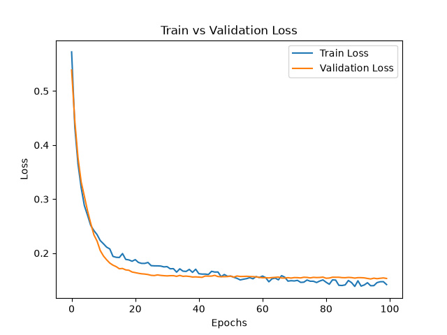


After 20 epochs the validation loss does not really decrease any further. Hence we estimate the neural network with 20 epochs.

The neural network --like the logistic regression-- is compared on unseen test data:
- =model.predict()= returns probabilities; comparing the probabilities to $0.5$ converts them to binary predictions
- =.squeeze()= removes an unnecessary extra dimension from the output array; try yourself by typing =np.random.normal(size=(3,1)).squeeze()=.

#+BEGIN_SRC python :results output :exports both
model.fit(X_train_sc, y_train, epochs=20, batch_size=256, verbose=0,)

# ── Evaluate ──────────────────────────────────────────────────────────────────
nn_test_acc    = accuracy_score(y_test, (model.predict(X_test_sc, verbose=0).squeeze() > 0.5))
logit_test_acc = test_acc
print(f"Logistic regression  — Test accuracy: {logit_test_acc:.4f}")
print(f"Neural network       — Test accuracy: {nn_test_acc:.4f}")
print(f"Improvement: {nn_test_acc - logit_test_acc:+.4f}")
#+END_SRC


#+begin_src 
Logistic regression   Test accuracy: 0.9035
Neural network        Test accuracy: 0.9290
Improvement: +0.0255
#+end_src

The neural network captures non-linearities and interactions between features that logistic regression cannot. The network learns these automatically, although at the cost of interpretability (neural networks are often seen as a black box). The network achieves roughly 93% test accuracy versus 90% for logistic regression. 

*** Profit maximization
:PROPERTIES:
:CUSTOM_ID: lecture6-profit
:END:

Once we have an estimated demand model $\hat{P}(\text{buy} \mid q, p, X)$, we can compute the firm's expected profit at any $(q, p)$:

$$\pi(q, p) = \hat{P}(\text{buy} \mid q, p, X) \cdot (p - c(q))$$

and we assume that the unit cost of producing quality $q$ equals $c(q) = 0.5 q^2$.

We find the profit-maximizing $(q^*, p^*)$ by numerical optimization (here using differential evolution, a global method that tends to avoid local maxima). We evaluate the predicted profit maximizing $p,q$ using the true profit function so we see whether better estimation leads to better decisions.

We make the following comparisons:
- we calculate the optimal $(q^*,p^*)$ for the true model; if the firm knows the underlying utility functions, this is the profit it would get;
- we derive the optimal $(q_{lr},p_{lr})$ for a firm maximizing profits using the demand function estimated with the logistic regression; then we calculate what the true profits will be if the firm brings $(q_{lr},p_{lr})$ to the market and
- we derive the optimal $(q_{nn},p_{nn})$ for a firm maximizing profits using the demand function estimated with the neural network; then we calculate what the true profits will be if the firm brings $(q_{nn},p_{nn})$ to the market.

Try =np.full(10,3)= to see what =np.full(n,q)= does. 

#+BEGIN_SRC python :results output :exports both
import numpy as np
from scipy.optimize import differential_evolution

def cost(q):
    return 0.5 * q**2

def profit_given_model(q, p, X, model_type='true'):
    n = len(X)
    X_arr = X.values if hasattr(X, 'values') else X
    if model_type == 'true':
        det_u    = utility(q, p, X_arr)
        prob_buy = 1.0 / (1.0 + np.exp(-det_u))
    elif model_type == 'nn':
        X_qp     = np.column_stack([X_arr, np.full(n, q), np.full(n, p)])
        prob_buy = model.predict(scaler.transform(X_qp), verbose=0).squeeze()
    elif model_type == 'logit':
        X_qp     = np.column_stack([X_arr, np.full(n, q), np.full(n, p)])
        prob_buy = logit.predict_proba(scaler.transform(X_qp))[:, 1]
    return float(np.mean(prob_buy * (p - cost(q))))

bounds  = [(1.0, 5.0), (1.0, 10.0)]
results = {}
for m in ['true', 'nn', 'logit']:
    def neg_profit(params, m=m):
        return -profit_given_model(params[0], params[1], consumers, m)
    res = differential_evolution(neg_profit, bounds, seed=42, maxiter=200, tol=1e-6)
    q_opt, p_opt = res.x
    results[m] = {
        'q*': q_opt,
        'p*': p_opt,
        'true_profit': profit_given_model(q_opt, p_opt, consumers, 'true'),
    }

print(f"{'Model':<12} {'q*':>7} {'p*':>7} {'True profit':>13}")
print("-" * 43)
for m, r in results.items():
    print(f"{m:<12} {r['q*']:>7.3f} {r['p*']:>7.3f} {r['true_profit']:>13.4f}")

nn_gain = (results['nn']['true_profit'] - results['logit']['true_profit'])
nn_gain_pct = nn_gain / results['logit']['true_profit'] * 100
print(f"\nNN profit gain over logit: {nn_gain:.4f}  ({nn_gain_pct:.1f}%)")
print(f"Upper bound (true model):  {results['true']['true_profit']:.4f}")
#+END_SRC

: NN profit gain over logit: 0.1258  (47.2%)
: Upper bound (true model):  0.4189

The results show that better demand estimation pays off directly in terms of profits:

| Model               | $q^*$ | $p^*$ | True profit |
|---------------------+-------+-------+-------------|
| True model          | 1.137 | 1.705 |      0.4189 |
| Neural network      | 1.047 | 1.907 |      0.3924 |
| Logistic regression | 1.012 | 2.527 |      0.2666 |

The neural network recovers 91% of the true model's profit, while logistic regression recovers only 64%.  The profit gain of the neural network over logistic regression is roughly 47%.

The economic intuition: logistic regression appears to under-estimate both the price sensitivity and quality valuation of consumers (because it cannot represent the relevant interactions). Therefore it recommends too high a price at too low a quality level. The neural network captures this heterogeneity and recommends a price closer to the true optimum.

Above we consider the case where the firm offers one option $(q,p)$ for all consumers. But the firm could develop a menu of options targeted at different consumer groups. It goes too far to present this analysis and the Python code here, but this also illustrates the lack of interaction terms in the logistic regression.

#+caption: Price discrimination based on the estimated demand and the true underlying model
#+attr_latex: scale=0.3
#+name: fig:PriceDiscriminationNN
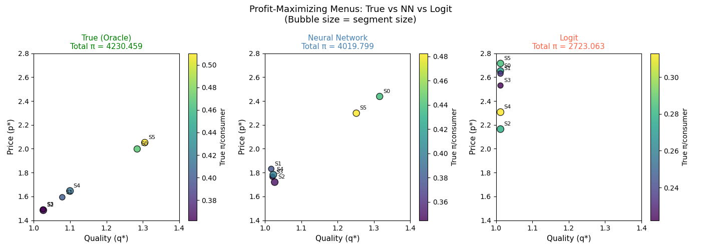

Figure ref:fig:PriceDiscriminationNN illustrates the situation where the firm clusters its customers into six segments. We assume that through targeted marketing the firm can offer each segment its own bundle $(q,p)$ without worrying about incentive compatibility constraints (i.e. first-degree price discrimination). In the true model (where the firm has an oracle to learn the underlying utility functions), the profit maximizing menu of choices differentiates in both quality and prices. With a neural network the firm differentiates between low and high valuation consumers but does not pick up the differentiation among the low types. Perhaps with more observations the neural network would improve the low valuation offerings in its menu. The firm basing its marketing on a logistic regression fails to identify the interactions completely and does not differentiate its quality offerings.


** Summary
:PROPERTIES:
:CUSTOM_ID: lecture6-summary
:END:

- *ReLU basis functions* span the space of piecewise-linear functions.  Adding more ReLUs reduces approximation error; in a trained neural network the knot positions are learned jointly with the amplitudes.
- *Discrete-choice demand* can be estimated as a binary classification problem: a sigmoid output gives a purchase probability, and binary cross-entropy is the natural loss function.
- *Logistic regression* fitting a linear relationship misses non-linear interactions between consumer characteristics, quality, and price.  A neural network with two or three hidden layers captures these interactions and achieves higher out-of-sample accuracy.
- *Train/validation loss curves* reveal over-fitting and under-fitting.  Use them to choose depth and training duration.
- *Profit impact*: in our example a 3 percentage-point accuracy improvement translates into a 43% profit gain at the optimal price.

** Review Questions
:PROPERTIES:
:CUSTOM_ID: lecture6-review
:END:

1. The universal approximation theorem states that a neural network with a single hidden layer and enough units can approximate any continuous function.  Why does this not mean that one hidden layer is always sufficient in practice?

2. In the demand model, the price coefficient $\beta(x)$ varies across consumers.  Explain why logistic regression cannot capture this heterogeneity and what the estimation consequence is.

3. A student trains a demand network and finds that train accuracy is 95% but validation accuracy is 72%.  What is wrong and how would you fix it?

4. Why is profit a better evaluation criterion than accuracy when comparing demand models for a pricing application?

5. In the profit-maximisation results, the neural network recommends a lower price than logistic regression ($p^* = 1.94$ vs $p^* = 2.53$).  Using the structure of the utility model, explain why logistic regression overestimates the optimal price.

--------------------

#+BEGIN_EXPORT latex
\newpage
#+END_EXPORT

* Lecture 7: An empirical and theoretical application of neural networks

--------------------

#+BEGIN_EXPORT latex
\newpage
#+END_EXPORT
* Course takeaway: simulation as a bridge to machine learning

These lectures show that the gap between classical econometrics and modern machine learning is smaller than it appears. OLS, the workhorse of econometrics, is just a specific loss function minimised by a simple algorithm. Ridge and lasso are OLS with an extra line of code. Neural networks are deeper versions of the same idea.

By building everything from scratch using simulation and optimisation, you develop a type of understanding that no amount of reading about formulas can give. You see directly what the parameters do, how the estimates vary, and what happens when assumptions break down.

--------------------

#+BEGIN_EXPORT latex
\newpage
#+END_EXPORT


* Bibliography
#+cite_export: csl ./chicago-author-date.csl
#+bibliography:~/Nextcloud2/Literature/references.bib
#+print_bibliography:


#+BEGIN_EXPORT html
</main>
#+END_EXPORT
